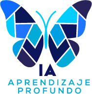

<p align="center">
  
</p>

# Hydro-Lab G2.4 / S2.11

**Laboratorio educativo de inteligencia artificial avanzada para una red sintética de transporte de hidrocarburos.**

**Desarrollo de Hydro-Lab:** Álvaro Montenegro — Aprendizaje Profundo SAS.

Hydro-Lab es un desarrollo de software independiente, concebido especialmente como recurso didáctico para el curso de Inteligencia Artificial Avanzada de la Universidad de los Andes y Ecopetrol.

El laboratorio permite estudiar decisiones secuenciales, optimización, control y aprendizaje por refuerzo mediante experimentos reproducibles. La versión S2.11 incorpora entrenamiento, evaluación y comparación de políticas mediante *Proximal Policy Optimization* (PPO).

> **Alcance:** Hydro-Lab utiliza una instalación enteramente sintética. No contiene datos industriales reales, no está calibrado para activos de Ecopetrol y no debe utilizarse para operar infraestructura física.

## Acceso al curso y sus materiales

Los materiales académicos del curso fueron adaptados a partir de recursos educativos de Aprendizaje Profundo, desarrollados por Álvaro Montenegro, Daniel Montenegro y Pilar Montenegro.

| Recurso | Acceso |
|---|---|
| Programa académico | [Syllabus G2.5](docs/01_curso/syllabus/Syllabus_IA_Avanzada_Ecopetrol_Uniandes_G2.5.md) |
| Lecciones prácticas | [Diez cuadernos Jupyter: ocho principales y dos complementarios](docs/01_curso/lecciones/Cuadernos/) |
| Recursos visuales | [Imágenes y GIFs de las lecciones](docs/01_curso/lecciones/Imagenes/) |
| Laboratorio | [Manual de Hydro-Lab S2.11](docs/03_laboratorio/manuales/Manual_Hydro_Lab_S2.11_G3.1.md) |
| Fundamentos y actividades | [Guía de estudiantes](docs/03_laboratorio/manuales/Guia_Estudiantes_Hydro_Lab_S2.11_G3.4.md) |
| Documentación general | [Índice de documentación](docs/README.md) |

### Índice de cuadernos Jupyter

Las lecciones 101–108 mantienen la secuencia docente principal. Las lecciones **102A** y **103A** son complementos oficiales de profundización: pueden utilizarse durante la clase, sin añadir horas al programa.

| Sesión | Cuaderno | Tema | Función |
|---|---|---|---|
| 1 | [101](docs/01_curso/lecciones/Cuadernos/101_ar_MDP_Fundamentos.ipynb) | Fundamentos de MDP | Principal |
| 1 | [102](docs/01_curso/lecciones/Cuadernos/102_ar_Q_Learning_DQN.ipynb) | Q-learning y DQN | Principal |
| 1 | [102A](docs/01_curso/lecciones/Cuadernos/102A_ar_Deep_Q_Learning_Experiencias.ipynb) | Deep Q-Learning: aprender de la experiencia | Complementario |
| 2 | [103](docs/01_curso/lecciones/Cuadernos/103_ar_Gradientes_Actor_Critico.ipynb) | Gradientes de política y Actor-Crítico | Principal |
| 2 | [103A](docs/01_curso/lecciones/Cuadernos/103A_ar_Actor_Critico_PPO.ipynb) | Actor-Crítico y PPO | Complementario |
| 2 | [104](docs/01_curso/lecciones/Cuadernos/104_ar_PPO_Hydro_Lab.ipynb) | PPO y control en Hydro-Lab | Principal |
| 3 | [105](docs/01_curso/lecciones/Cuadernos/105_ar_Optimizacion_Bayesiana.ipynb) | Optimización bayesiana | Principal |
| 3 | [106](docs/01_curso/lecciones/Cuadernos/106_ar_Optimizacion_Multiobjetivo.ipynb) | Optimización multiobjetivo | Principal |
| 4 | [107](docs/01_curso/lecciones/Cuadernos/107_ar_Meta_Learning.ipynb) | Meta-learning | Principal |
| 4 | [108](docs/01_curso/lecciones/Cuadernos/108_ar_RL_Investigacion_Operaciones.ipynb) | RL e Investigación de Operaciones | Principal |

Los cuadernos pueden consultarse directamente en GitHub. Para ejecutarlos se requiere un entorno Jupyter con las dependencias correspondientes. La visualización de un cuaderno en GitHub no ejecuta sus celdas.

Los recursos gráficos incluyen imágenes PNG y animaciones GIF; algunos cuadernos pueden conservar espacios reservados para insertar visualizaciones pendientes. La presencia de un archivo en `Imagenes/` no implica que ya esté incrustado en el cuaderno correspondiente.

El curso utiliza los cuadernos como material conceptual y práctico. Hydro-Lab constituye el entorno experimental complementario para estudiar el comportamiento de una red simulada y comparar estrategias de decisión.

## Funcionalidades del laboratorio

Hydro-Lab permite:

- Simular una red sintética de transporte de hidrocarburos con tanques, bombas, tuberías, demanda variable y restricciones operativas.
- Explorar la operación manual y automática.
- Comparar estrategias de control y analizar episodios.
- Estudiar observaciones, acciones, recompensas y terminaciones en un entorno de aprendizaje por refuerzo.
- Utilizar un robot de inspección simulado.
- Entrenar políticas PPO con Stable-Baselines3 y PyTorch.
- Evaluar políticas frente a estrategias de referencia y examinar diagnósticos y resultados guardados.

La aplicación está desarrollada en Python y utiliza Streamlit como interfaz local.

## Obtener el repositorio

Repositorio oficial: [AprendizajeProfundo/hydro-lab](https://github.com/AprendizajeProfundo/hydro-lab).

Puedes descargarlo mediante **Code → Download ZIP** desde GitHub o clonarlo:

```bash
git clone https://github.com/AprendizajeProfundo/hydro-lab.git
cd hydro-lab
```

El acceso al repositorio dependerá de su configuración de visibilidad y de los permisos correspondientes.

## Requisitos

- Python 3.12.
- Un navegador moderno para utilizar Streamlit.
- Un entorno virtual de Python, administrado con Conda o `venv`.
- Conexión a Internet para instalar las dependencias iniciales.

El entrenamiento PPO puede ejecutarse en CPU. Su duración dependerá de las características del equipo y de la configuración del experimento.

Las instrucciones contemplan macOS, Linux y Windows. La compatibilidad completa en las tres plataformas requiere pruebas de integración específicas.

## Instalación con Conda

Desde la raíz del repositorio:

```bash
conda create -n hydro-lab python=3.12 -y
conda activate hydro-lab
python -m pip install -e ".[dev,ui,ppo,course]"
python -m pytest -q
python -m streamlit run dashboard/app.py
```

## Instalación con Python `venv`

### macOS y Linux

```bash
python3.12 -m venv .venv
source .venv/bin/activate
python -m pip install -e ".[dev,ui,ppo,course]"
python -m pytest -q
python -m streamlit run dashboard/app.py
```

### Windows PowerShell

```powershell
py -3.12 -m venv .venv
.\.venv\Scripts\python.exe -m pip install -e ".[dev,ui,ppo,course]"
.\.venv\Scripts\python.exe -m pytest -q
.\.venv\Scripts\python.exe -m streamlit run dashboard/app.py
```

La interfaz estará disponible normalmente en [http://localhost:8501](http://localhost:8501). Para detener la aplicación, utiliza **Ctrl+C** en la terminal.

## Dependencias

El archivo [`pyproject.toml`](pyproject.toml) define las dependencias principales y los grupos opcionales:

| Grupo | Propósito |
|---|---|
| Dependencias principales | NumPy, SciPy y Gymnasium |
| `dev` | Pruebas automatizadas con pytest |
| `ui` | Interfaz con Streamlit, Plotly y pandas |
| `ppo` | Aprendizaje por refuerzo con Stable-Baselines3 y PyTorch |
| `course` | Cuadernos Jupyter: Matplotlib, scikit-learn, JupyterLab e ipykernel |

Para instalar el laboratorio completo y todas las dependencias del curso:

```bash
python -m pip install -e ".[dev,ui,ppo,course]"
```

La instalación del entorno S2.11 fue verificada previamente con Python 3.12 y 125 pruebas automatizadas aprobadas. Las nuevas lecciones 102A y 103A requieren su propia verificación de ejecución antes de afirmar que toda la ampliación ha sido validada.

## Entrenamiento y evaluación PPO

La sección **Aprendizaje por refuerzo · PPO** permite configurar y ejecutar entrenamientos, consultar su progreso, seleccionar checkpoints, evaluar políticas y comparar resultados con estrategias de referencia.

Para interpretar correctamente los resultados es necesario conservar la configuración experimental, las semillas, los parámetros de entrenamiento y los artefactos de normalización correspondientes.

Una ejecución aislada no demuestra la superioridad de una política. Las comparaciones requieren condiciones experimentales controladas y, cuando corresponda, múltiples semillas.

## Validación y reproducibilidad

La suite automatizada está disponible en [`tests/`](tests/).

En la revisión local previa de S2.11 se ejecutaron satisfactoriamente **125 pruebas**. Este resultado no implica por sí mismo compatibilidad certificada con todas las plataformas ni validación de los cuadernos incorporados posteriormente.

Los resultados y checkpoints se generan localmente. La carpeta `resultados/` está excluida del control de versiones.

## Documentación científica y técnica

- [Especificación matemática y computacional G2.4](docs/03_laboratorio/arquitectura/Red_Hidrocarburos_Especificacion_Matematica_Computacional_G2.4.md)
- [Diseño científico G2.3](docs/02_fundamentos/diseno_cientifico/Laboratorio_Red_Inteligente_Hidrocarburos_Diseno_Cientifico_G2.3.md)
- [Documentación del desarrollo PPO S2.11](docs/06_desarrollo/S2.11_PPO/)
- [Documentación de recompensas S2.10](docs/06_desarrollo/S2.10_Recompensas/)
- [Historial de cambios](CHANGELOG.md)

Los identificadores de generación y versión se conservan para documentar la evolución del proyecto.

## Autoría y reconocimientos

**Hydro-Lab:** diseño y desarrollo por Álvaro Montenegro, Aprendizaje Profundo SAS.

**Materiales académicos:** los cuadernos del curso constituyen adaptaciones de materiales de Aprendizaje Profundo, con autoría atribuida a Álvaro Montenegro, Daniel Montenegro y Pilar Montenegro.

**Ilustraciones:** las imágenes originales fueron elaboradas por los autores; algunas se produjeron con asistencia de ChatGPT. Los recursos de terceros, cuando existan, mantienen sus atribuciones y condiciones particulares.

La referencia al curso de la Universidad de los Andes y Ecopetrol identifica su contexto académico y no implica que el laboratorio represente instalaciones reales de estas entidades.

## Licencia

Los componentes originales del repositorio sobre los que sus titulares poseen derechos licenciables se distribuyen bajo la **licencia MIT**. Consulta el archivo [`LICENSE`](LICENSE).

Los cuadernos 101–108 cuentan con un [aviso específico de licencia y alcance](docs/01_curso/lecciones/Cuadernos/LICENSE_Cuadernos_Curso.txt). Debe verificarse expresamente si dicho aviso también comprende los nuevos cuadernos 102A y 103A.

La licencia del proyecto no modifica los derechos sobre materiales, bibliotecas, marcas, imágenes o contenidos de terceros.

---

**Aprendizaje Profundo SAS · 2026**
