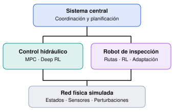

# Inteligencia artificial avanzada aplicada a retos estratégicos

## Dominio técnico avanzado: sistemas que aprenden, optimizan y deciden

**Syllabus académico — Generación 2, versión 0.3 (G2.3)**  
**Programa:** IA avanzada aplicada a retos estratégicos  
**Contexto académico:** Ecopetrol — Universidad de los Andes  
**Modalidad:** Presencial, sede Universidad de los Andes  
**Duración:** 8 horas presenciales distribuidas en dos jornadas de 4 horas; 440 minutos académicos y 40 minutos de pausas  
**Docente y autor:** Álvaro Montenegro  
**Cargo:** CEO, Learning Systems Institute (LSI) y Aprendizaje Profundo SAS  
**Correo electrónico:** ammontenegrod@gmail.com  
**Celular:** +57 300 571 2192  
**Fecha:** Bogotá, 18 de octubre de 2026  
**Estado:** Diseño académico G2.3 para validación; experimentos y resultados aún sujetos a implementación y pruebas  
**Antecedentes preservados:** `Syllabus_IA_Avanzada_Ecopetrol_Uniandes_G0.2.md` y `Syllabus_IA_Avanzada_Ecopetrol_Uniandes_G2.1.md`

---

## 1. Presentación

La inteligencia artificial ha ampliado extraordinariamente nuestra capacidad para reconocer patrones y construir predicciones. Sin embargo, una predicción precisa no es necesariamente una buena decisión. En ingeniería y gestión, decidir significa intervenir sobre un sistema, modificar su evolución y asumir consecuencias que solo se manifiestan después. La pregunta deja de ser únicamente *¿qué ocurrirá?* y pasa a ser *¿qué debemos hacer, con qué información y bajo cuáles restricciones?*

Este curso intensivo estudia el tránsito desde la analítica predictiva hacia **sistemas que aprenden, optimizan y toman decisiones secuenciales**, mediante aprendizaje por refuerzo, control, optimización basada en aprendizaje e investigación de operaciones.

La Generación 2 mantiene **un único laboratorio científico acumulativo**, denominado *Intelligent Hydrocarbon Transportation Network*: una red sintética de transporte de hidrocarburos con estaciones de bombeo, segmentos de tubería, almacenamiento, demandas variables, sensores, perturbaciones y un robot autónomo de inspección. El sistema evoluciona durante el curso: primero se comprende su funcionamiento, luego se controla, optimiza, adapta y coordina.

El laboratorio no representa instalaciones reales de Ecopetrol ni reproduce datos, configuraciones o proyectos de sus participantes. Su propósito es construir un mundo artificial verificable en el cual diferentes métodos puedan compararse bajo condiciones experimentales controladas.

El hilo conductor será **un solo sistema industrial, múltiples problemas de decisión y distintos paradigmas de solución**. No se presupone que el aprendizaje por refuerzo sea superior al control predictivo o a la optimización convencional; la selección de métodos deberá justificarse mediante supuestos, restricciones y evidencia.

## 2. Propósito y resultados de aprendizaje

**Propósito general.** Desarrollar criterios conceptuales, matemáticos y computacionales para formular, resolver y evaluar problemas industriales de decisión secuencial y optimización, distinguiendo el papel del aprendizaje automático, el control y la investigación de operaciones.

Al finalizar, se espera que los participantes puedan:

1. Distinguir predicción, optimización estática, control y decisión secuencial; reconocer cuándo es pertinente utilizar RL y cuándo convienen alternativas convencionales.
2. Formular un proceso de decisión de Markov (MDP) con estados, observaciones, acciones, transiciones, recompensas, políticas, restricciones e incertidumbre; reconocer problemas de observabilidad parcial.
3. Explicar la relación entre funciones de valor, ecuación de Bellman, aproximación neuronal, Deep RL y gradientes de política, e interpretar el entrenamiento de una política PPO.
4. Analizar decisiones operacionales acopladas en una red, sus consecuencias diferidas y los compromisos entre costo energético, entregas, integridad y restricciones.
5. Comprender la optimización bayesiana como estrategia para elegir evaluaciones informativas de una función costosa y representar compromisos multiobjetivo mediante dominancia de Pareto.
6. Diferenciar transferencia, reentrenamiento y meta-learning; identificar cómo evaluar adaptación rápida ante tareas y condiciones nuevas.
7. Explicar una arquitectura jerárquica que combine planificación matemática, control y un agente robótico de inspección; valorar el efecto de adquirir información sobre las decisiones.
8. Evaluar resultados con líneas base, métricas, separación de escenarios, incertidumbre, pruebas de robustez, ablaciones y análisis de fallos.

La sesión contribuye a los objetivos institucionales de planteamiento de problemas, selección de enfoques analíticos, interpretación de datos, validación de resultados y comprensión de arquitecturas tecnológicas sostenibles. **No constituye una asesoría a los proyectos de los participantes ni compromete prototipos industriales durante las ocho horas.**

## 3. Participantes y estrategia de profundidad

La audiencia combina profesionales con formación avanzada en analítica, estadística y ciencia de datos —incluidos perfiles de posgrado— con profesionales de negocio menos familiarizados con programación y modelado matemático.

Se emplearán **dos niveles simultáneos de lectura**:

- **Operacional:** qué información existe, qué se decide, cuáles son los costos, restricciones y consecuencias, y cómo interpretar una gráfica científica.
- **Matemático-computacional:** qué variables constituyen el estado, cómo se construye el modelo, qué objetivo se optimiza, qué algoritmo se aplica, qué supuestos requiere y cómo se valida.

Se distinguirán tres profundidades: **fundamentos esenciales** (MDP, Bellman, decisiones secuenciales); **desarrollo aplicado y comparación experimental** (Deep RL, policy gradients, optimización bayesiana y multiobjetivo); e **introducción especializada funcional** (meta-learning y RL + investigación de operaciones). La diferencia obedece al tiempo disponible, no a la importancia de los temas.

Comprender un método, ejecutarlo e implementarlo desde cero son resultados distintos. Se espera comprensión crítica de todos; las derivaciones extensas y modificaciones de código serán material opcional de profundización.

## 4. Requisitos y correquisitos mínimos

### 4.1. Requisitos de entrada

Se requiere familiaridad conceptual —no dominio algorítmico— con problemas de analítica y decisión, nociones básicas de modelos predictivos, probabilidad, estadística y optimización, y lectura de gráficas e indicadores.

**No se exige** programar en Python, conocer RL, dominar cálculo estocástico o tener experiencia previa en simulación hidráulica o robótica.

### 4.2. Correquisitos introducidos durante la sesión

Se presentarán oportunamente estados y acciones, función objetivo, restricciones, incertidumbre, políticas, optimización secuencial, nociones de Python y lectura de notebooks. Una guía preparatoria breve y opcional podrá facilitar el seguimiento, sin imponer instalaciones individuales.

## 5. Laboratorio integrado: Intelligent Hydrocarbon Transportation Network

### 5.1. Mundo físico sintético

El laboratorio representará una red pequeña y explícita, inicialmente con aproximadamente cuatro o cinco nodos operativos y dos ramas alternativas. Sus componentes previstos incluyen estaciones de bombeo, tuberías, almacenamiento, demanda, tarifas energéticas, sensores y perturbaciones como cambios de viscosidad, pérdidas de eficiencia o reducción de capacidad.

El modelo deberá respetar balances de masa, relaciones hidráulicas y límites operativos dentro del nivel de abstracción adoptado. Se contempla un esquema **hidráulico cuasiestacionario por intervalo de decisión**, combinado con dinámicas discretas de inventario, demanda y estado de equipos. No se pretende simular transitorios rápidos como golpes de ariete ni certificar condiciones de seguridad de un oleoducto real.

La formulación matemática definitiva, los parámetros y las pruebas de coherencia física se desarrollarán en un documento técnico separado, no en este syllabus.

### 5.2. Arquitectura jerárquica de decisión

El sistema tendrá un **nivel central de coordinación** que establece prioridades de operación, cumplimiento de entregas y necesidades de inspección; un **módulo de control hidráulico** que determina acciones de bombeo dentro de límites admisibles; y un **robot de inspección** que planifica o ejecuta visitas, adquiere observaciones y reporta hallazgos simulados.

*Figura 1. Arquitectura conceptual del laboratorio integrado. Archivo local: `arquitectura-conceptual.svg` (ubicar en la misma carpeta que este Markdown). La figura representa una propuesta de diseño, no un sistema ya implementado.*

La jerarquía separará decisiones estratégicas, operacionales y de ejecución. No se presupone que todas las decisiones deban aprenderse: las restricciones duras, la factibilidad y parte de la planificación podrán tratarse con métodos deterministas o de investigación de operaciones.

### 5.3. El robot como instrumento de decisión e información

El robot no será una animación decorativa. Se moverá en un grafo de accesibilidad de instalaciones, con tiempos de desplazamiento, disponibilidad y presupuesto de energía. El sistema central establecerá prioridades de inspección; el robot resolverá la ejecución bajo restricciones y podrá adaptar su comportamiento a cambios del entorno.

Sus inspecciones aportarán observaciones adicionales —por ejemplo, sobre el deterioro de una bomba— que pueden modificar las decisiones de operación. Esto permitirá introducir **observabilidad parcial y valor de la información**: una inspección puede ser valiosa no solo por detectar una anomalía, sino por cambiar una decisión posterior.

Se evitará afirmar que el robot realiza mantenimiento físico real. Las posibles intervenciones se limitarán a eventos abstractos de simulación, claramente diferenciados de la inspección.

## 6. Cobertura explícita de los ocho temas institucionales

| Eje | Tema requerido | Desarrollo dentro del laboratorio integrado |
|---|---|---|
| Aprendizaje por refuerzo | **MDP avanzados** | Estados hidráulicos e inventarios, acciones de bombeo, transiciones estocásticas, restricciones, observaciones parciales y horizonte de decisión. |
| Aprendizaje por refuerzo | **Deep RL** | Políticas y funciones de valor aproximadas con redes neuronales; comparación con reglas operativas y MPC. |
| Aprendizaje por refuerzo | **Policy gradients** | Fundamento del gradiente de política, objetivo de entrenamiento y demostración de PPO con datos del simulador. |
| Aprendizaje por refuerzo | **RL aplicado a decisiones secuenciales** | Consecuencias diferidas, demanda variable, costos acumulados, exploración y desempeño bajo perturbaciones. |
| Optimización basada en aprendizaje | **Bayesian Optimization** | Calibración de parámetros de un controlador o selección de configuraciones operativas mediante evaluaciones costosas, modelo sustituto y adquisición. |
| Optimización basada en aprendizaje | **Meta-learning** | Distribución explícita de tareas (viscosidad, demanda, capacidad); metaentrenamiento y evaluación de adaptación a tareas no vistas frente a transferencia y reentrenamiento. |
| Optimización basada en aprendizaje | **RL + Investigación de Operaciones** | Planificación factible de rutas y visitas del robot con OR, coordinada con políticas adaptativas y decisiones centrales. |
| Optimización basada en aprendizaje | **Optimización multiobjetivo** | Compromisos entre energía, entregas, riesgo operacional, desgaste e inspección; soluciones no dominadas y frontera de Pareto. |

Los ocho temas se cubrirán de manera verificable, **sin pretender desarrollar exhaustivamente ocho campos de investigación en ocho horas**. La profundidad y el énfasis serán proporcionales a su función dentro del experimento.

## 7. Secuencia metodológica: un mundo, cinco niveles

### Nivel I. La red funciona, pero aún no aprende

Se presenta el sistema físico, sus sensores y decisiones, y una política de operación por reglas. Se examinan inventarios, caudales, presiones, consumo y demanda; se formaliza el MDP y se discute cuándo el estado no es completamente observable.

**Pregunta guía:** ¿qué información y qué modelo hacen posible una buena decisión?

### Nivel II. La red aprende a operar

Se introduce Bellman, la aproximación neuronal y los gradientes de política. Una política PPO previamente entrenada se compara con reglas y, cuando sea técnicamente factible, con un controlador predictivo MPC. Se observan recompensas, costos y violaciones de restricciones bajo escenarios equivalentes.

**Pregunta guía:** ¿qué ha aprendido realmente la política y cómo lo demostramos?

### Nivel III. La red aprende a optimizar su configuración

Se plantea una función costosa de evaluar, como el desempeño agregado de una configuración de control. Se comparan búsqueda aleatoria y optimización bayesiana con presupuesto común de evaluaciones. Se analizan objetivos contrapuestos y un frente de Pareto aproximado.

**Pregunta guía:** ¿qué experimento conviene realizar a continuación y qué significa una solución óptima con varios objetivos?

### Nivel IV. La red se enfrenta a condiciones nuevas

Se definen tareas diferenciadas por condiciones hidráulicas y operativas. Se contrasta una política fija, adaptación convencional y un mecanismo explícito de meta-learning. Se medirá desempeño antes y después de un presupuesto pequeño de adaptación, en tareas separadas de las usadas para metaentrenar.

**Pregunta guía:** ¿qué puede aprenderse entre tareas para adaptarse más rápidamente a una nueva?

### Nivel V. La red coordina operación e inspección robótica

El nivel central prioriza inspecciones; un planificador de investigación de operaciones organiza visitas factibles y el robot ejecuta decisiones adaptativas. Las observaciones obtenidas actualizan la información disponible para el control hidráulico. Se estudian rutas, restricciones, incertidumbre y valor de la información.

**Pregunta guía:** ¿cuándo es mejor invertir recursos en observar el sistema antes de actuar sobre él?

En todos los niveles se repetirá el ciclo **problema → modelo → referencia → técnica → experimento comparativo → interpretación crítica**. Las demostraciones se prepararán y validarán antes de la sesión; no se dependerá de entrenamientos extensos en vivo.

## 8. Programación académica completa — 27 y 28 de octubre de 2026

**Formato aprobado:** cuatro sesiones de **110 minutos** cada una, dos por jornada, separadas por una pausa de **20 minutos**. Cada jornada suma $110+20+110=240$ minutos (4 horas presenciales). Total: **440 minutos de formación y 40 minutos de pausas = 480 minutos presenciales**. Las fechas corresponden a martes 27 y miércoles 28 de octubre de 2026.

**Horarios de reloj:** la Universidad confirmará la hora de inicio de cada jornada. Para evitar inventar una convocatoria, la programación se expresa en minutos transcurridos desde el inicio del día; las franjas relativas son definitivas, no horas oficiales.

### Día 1 — Martes 27 de octubre: formulación y aprendizaje por refuerzo

| Franja relativa | Duración | Sesión / actividad |
|---|---:|---|
| 00:00–01:50 | 110 min | **Sesión 1. MDP avanzados y RL aplicado a decisiones secuenciales** |
| 01:50–02:10 | 20 min | Pausa |
| 02:10–04:00 | 110 min | **Sesión 2. Deep RL y policy gradients** |

#### Sesión 1 — El problema de decidir: de la física al MDP (110 minutos)

**Contenidos institucionales:** MDP avanzados; RL aplicado a decisiones secuenciales.

| Minutos de sesión | Duración | Desarrollo y evidencia |
|---|---:|---|
| 0–10 | 10 | Apertura: predicción, optimización, control y decisiones; pregunta industrial guía |
| 10–25 | 15 | Red sintética única: nodos, dos ramas, bombas, tanques, demanda y restricciones; ejecución de una política por reglas |
| 25–50 | 25 | Construcción del MDP: estado, acción, transición, recompensa, horizonte, descuento y política; observabilidad parcial |
| 50–70 | 20 | Retornos, función de valor, ecuaciones de Bellman y efecto de consecuencias diferidas |
| 70–90 | 20 | Demostración: dos decisiones locales con resultados acumulados distintos; exploración de demanda y tarifa |
| 90–105 | 15 | Restricciones, fallos de recompensa y distinción entre MDP, POMDP y decisión con seguridad |
| 105–110 | 5 | Síntesis: identificar formalmente el problema que resolverá PPO |
| **Total** | **110** | |

**Evidencia esperada:** ficha MDP del sistema, trayectorias comparables y explicación de por qué una acción aparentemente barata puede ser mala a largo plazo. **Pregunta de contraste:** ¿cuándo un controlador por reglas basta y cuándo la secuencia exige una política adaptativa?

#### Sesión 2 — De Bellman a las políticas neuronales (110 minutos)

**Contenidos institucionales:** Deep RL; policy gradients.

| Minutos de sesión | Duración | Desarrollo y evidencia |
|---|---:|---|
| 0–15 | 15 | Limitaciones de tablas de valor; aproximación de valor y política mediante redes |
| 15–35 | 20 | Objetivo de política, gradiente logarítmico, retornos, ventaja y estimación con trayectorias |
| 35–55 | 20 | Actor–critic y PPO: razón de probabilidades, objetivo recortado, estabilidad y límites |
| 55–75 | 20 | Demostración de entrenamiento precomputado: curvas, semillas, acciones, convergencia y fallos |
| 75–95 | 20 | Comparación en escenarios pareados: reglas, MPC simplificado cuando esté validado, y PPO; energía, servicio y seguridad |
| 95–105 | 10 | Prueba de estrés: cambios de demanda/viscosidad y generalización fuera de distribución |
| 105–110 | 5 | Síntesis: criterios para elegir o descartar Deep RL |
| **Total** | **110** | |

**Evidencia esperada:** curvas y métricas separadas de la recompensa; discusión de restricciones duras, sobreajuste al simulador y costo de entrenamiento. **Pregunta de contraste:** ¿qué aprendió PPO y qué no podemos concluir de una curva creciente?

### Día 2 — Miércoles 28 de octubre: optimización y adaptación

| Franja relativa | Duración | Sesión / actividad |
|---|---:|---|
| 00:00–01:50 | 110 min | **Sesión 3. Bayesian Optimization y optimización multiobjetivo** |
| 01:50–02:10 | 20 min | Pausa |
| 02:10–04:00 | 110 min | **Sesión 4. Meta-learning y RL + Investigación de Operaciones** |

#### Sesión 3 — Aprender dónde evaluar y cómo negociar objetivos (110 minutos)

**Contenidos institucionales:** Bayesian Optimization; optimización multiobjetivo.

| Minutos de sesión | Duración | Desarrollo y evidencia |
|---|---:|---|
| 0–10 | 10 | Retomar la red: ¿qué parámetros del controlador conviene ajustar? |
| 10–30 | 20 | Función objetivo costosa, presupuesto, exploración–explotación, modelo sustituto e incertidumbre |
| 30–50 | 20 | Adquisición: Expected Improvement o UCB; seleccionar la siguiente evaluación |
| 50–70 | 20 | Experimento pareado: búsqueda aleatoria vs BO con presupuesto idéntico |
| 70–85 | 15 | Objetivos en conflicto: energía, demanda servida, desgaste e inspección |
| 85–100 | 15 | Dominancia, no dominancia, aproximación a frente de Pareto y preferencias |
| 100–110 | 10 | Decisión ejecutiva: seleccionar una solución justificando sus compromisos |
| **Total** | **110** | |

**Evidencia esperada:** secuencia de evaluaciones, incertidumbre de sustituto, curva de mejor valor encontrado y conjunto no dominado. **Pregunta de contraste:** ¿por qué un óptimo de un indicador puede ser una mala decisión industrial?

#### Sesión 4 — Aprender a adaptarse y coordinar decisiones (110 minutos)

**Contenidos institucionales:** Meta-learning; RL + Investigación de Operaciones.

| Minutos de sesión | Duración | Desarrollo y evidencia |
|---|---:|---|
| 0–15 | 15 | Distribución de tareas: demanda, viscosidad, capacidad y condiciones de operación |
| 15–35 | 20 | Transferencia vs fine-tuning vs meta-learning; Reptile/MAML de primer orden en problema reducido |
| 35–55 | 20 | Experimento de adaptación: tareas de prueba disjuntas, desempeño frente a muestras de adaptación |
| 55–70 | 15 | Robot simplificado: grafo de acceso, prioridades, presupuesto de tiempo y batería |
| 70–90 | 20 | OR para rutas y asignación; integración con prioridades o ejecución adaptativa por RL |
| 90–100 | 10 | Comparación: no inspeccionar, calendario, rutas OR, coordinación informada; valor neto de la información |
| 100–110 | 10 | Síntesis final: mapa de decisión entre reglas, MPC, RL, BO, meta-learning y OR |
| **Total** | **110** | |

**Evidencia esperada:** curva de adaptación genuina con líneas base, ruta factible y efecto operacional de inspeccionar. **Pregunta de contraste:** ¿qué partes deben aprenderse y cuáles deben resolverse con optimización explícita?

### 8.1. Estrategia de continuidad entre sesiones

Las cuatro sesiones comparten **el mismo proceso generador de datos, topología, restricciones y convenciones**. Solo se modifica el problema de decisión y la técnica empleada. Los resultados de una sesión alimentan la pregunta siguiente; no se requiere aprender un entorno nuevo cada vez. Cada demostración seguirá **problema → formulación → línea base → método → comparación → límites**.

### 8.2. Gestión de tiempo y contingencias

Se emplearán resultados y políticas previamente entrenados, simulaciones breves, gráficas científicas reproducibles y una ruta de respaldo con artefactos guardados. No se reservarán minutos de clase para instalar dependencias, depurar hidráulica o entrenar modelos extensos. Si un componente experimental no supera sus pruebas, se presentará su formulación y un ejemplo reducido validado, sin inventar resultados ni afirmar una comparación inexistente.

## 9. Visualizaciones científicas, no desarrollo de tableros

La clase utilizará **figuras, animaciones ligeras o notebooks** preparados por el docente, únicamente cuando ayuden a comprender uno de los ocho temas:

1. **Sistema y decisión:** topología, flujos, presiones, inventarios, demanda, energía y acciones.
2. **Aprendizaje:** retornos, entrenamiento, desempeño por escenario y comparaciones de políticas.
3. **Optimización:** evaluaciones, incertidumbre del sustituto, adquisición y frente de Pareto aproximado.
4. **Adaptación:** rendimiento antes/después de adaptación, número de muestras y variación entre tareas.
5. **Inspección:** rutas factibles, tiempo, batería, mediciones y utilidad neta de la información.

Estas visualizaciones **no constituyen un tema del programa, un producto de software ni un compromiso de desarrollar un dashboard**. No se enseñarán gemelos digitales, redes neuronales de grafos ni construcción de interfaces. Los grafos de la red hidráulica y de accesibilidad robótica son **estructuras de modelación**, no modelos GNN.

## 10. Evidencia, rigor científico y seguridad conceptual

Cada demostración distinguirá el **mecanismo simulado**, el **método de solución** y la **evidencia de desempeño**. Se procurará:

- Documentar el proceso generador de datos, sus supuestos, unidades, restricciones y fuentes de incertidumbre.
- Verificar balances, factibilidad hidráulica simplificada y consistencia numérica antes de entrenar agentes.
- Comparar métodos bajo los mismos escenarios, semillas y presupuestos de evaluación cuando sean comparables.
- Separar entrenamiento, validación, prueba y, en meta-learning, tareas de metaentrenamiento y metaprueba.
- Medir costos energéticos, entregas, desviaciones, violaciones de restricciones, tiempos de cómputo y robustez; evitar depender únicamente de la recompensa agregada.
- Mostrar incertidumbre, sensibilidad y fallos deliberados, incluido *reward hacking*, sobreajuste al simulador y degradación fuera de distribución.
- Utilizar ablaciones para aislar el efecto del control aprendido, la optimización, la adaptación y la información del robot.

**Seguridad:** las penalizaciones en una recompensa no garantizan por sí solas el cumplimiento de restricciones críticas. El simulador deberá disponer de reglas explícitas de factibilidad, límites operativos y tratamiento de acciones inadmisibles. Ninguna política aprendida se presentará como apta para controlar infraestructura real.

Los resultados sintéticos **no constituyen evidencia de desempeño sobre instalaciones de Ecopetrol**. Una aplicación real exigiría datos autorizados, validación de ingeniería, calibración, análisis de riesgos, supervisión humana, ciberseguridad y procesos de aprobación pertinentes.

## 11. Recursos y modalidad de participación

La sesión combinará exposición conceptual, formulación matemática selectiva, demostraciones computacionales, interpretación de gráficas y resultados y discusión de decisiones. Se prepararán modelos y resultados reproducibles, con simulaciones breves y cambios de parámetros durante la clase.

La participación no dependerá de instalar software ni ejecutar código individualmente. Se podrán distribuir notebooks, configuraciones, resultados y material de profundización; los participantes técnicos tendrán acceso a detalles matemáticos y computacionales adicionales. No habrá taller ni evaluación de los proyectos particulares de los asistentes.

Las herramientas de IA para asistir la programación podrán mostrarse como apoyo opcional a la autonomía analítica, sin exigir servicios comerciales ni confundir generación de código con validación científica.

## 12. Herramientas computacionales — selección preliminar

Se privilegiará software gratuito y de código abierto, con ejecución local en equipos convencionales siempre que resulte factible. La selección final y compatibilidad se comprobarán en la fase de implementación.

| Función | Herramientas candidatas | Uso previsto |
|---|---|---|
| Lenguaje y desarrollo | Python 3.11+, JupyterLab, VS Code | Implementación y demostraciones |
| Simulación y análisis | NumPy, SciPy, pandas | Modelo hidráulico reducido, DGP y métricas |
| Aprendizaje profundo | PyTorch | Redes y entrenamiento |
| Aprendizaje por refuerzo | Gymnasium, Stable-Baselines3 | Interfaz de entorno y PPO |
| Optimización bayesiana | BoTorch, GPyTorch | Sustitutos probabilísticos y adquisición |
| Optimización multiobjetivo | pymoo, SciPy | Dominancia y aproximación del frente de Pareto |
| Investigación de operaciones | OR-Tools | Rutas, asignación y restricciones combinatorias |
| Meta-learning | PyTorch y código experimental documentado | Distribución de tareas y adaptación verificable |
| Visualización | Matplotlib, Plotly (opcional) | Tablero integrado y gráficas científicas |
| Reproducibilidad | Git, entornos fijados, semillas y archivos de configuración | Trazabilidad |

No se exigirán APIs comerciales de pago, GPU dedicada ni entrenamiento completo durante la clase. La factibilidad de cada componente será una condición de aceptación antes de fijar la versión docente.

## 13. Evaluación formativa y cierre

Esta sesión **no contempla evaluación calificativa**. La comprensión se promoverá mediante preguntas, predicción de resultados antes de ejecutar simulaciones, comparación de políticas, interpretación de restricciones y análisis crítico de decisiones metodológicas.

El cierre ofrecerá criterios para elegir entre reglas, MPC, optimización matemática, Deep RL, optimización bayesiana y arquitecturas híbridas, atendiendo a disponibilidad de modelos, costo de experimentar, restricciones, incertidumbre y evidencia de robustez.

## 14. Alcance de esta versión y decisiones pendientes

**G2.3 fija** el enfoque pedagógico de un laboratorio integrado, la arquitectura jerárquica conceptual, la cobertura de los ocho temas, el perfil de los participantes, la distribución temporal, los criterios de validación, las visualizaciones científicas y una selección tecnológica inicial.

**G2.3 no fija aún** las ecuaciones definitivas de la red, topología numérica, curvas de bombas, parametrización, dinámica de deterioro, sensores del robot, reglas de factibilidad, algoritmo final de meta-learning, funciones de recompensa, hiperparámetros, resultados experimentales ni arquitectura de software definitiva. Tales decisiones requieren especificación técnica y pruebas independientes, preservando las generaciones previas.

Las versiones G0.2, G2.1 y el diseño científico G2.2 permanecen como antecedentes históricos y no serán sobrescritos. G2.3 **no incorpora gemelos digitales**. El documento científico del laboratorio G2.3 desarrolla esta misma arquitectura con prioridad en un sistema único y demostraciones de bajo costo computacional.

## 15. Bibliografía seleccionada

### 15.1. Fundamentos de aprendizaje por refuerzo y decisiones secuenciales

1. Sutton, R. S., & Barto, A. G. (2018). *Reinforcement Learning: An Introduction* (2nd ed.). MIT Press. [Texto de los autores](http://incompleteideas.net/book/the-book-2nd.html). Referencia principal para MDP, Bellman, políticas y métodos de gradiente.
2. Puterman, M. L. (1994). *Markov Decision Processes: Discrete Stochastic Dynamic Programming*. Wiley. Fundamentación rigurosa de decisiones estocásticas secuenciales.
3. Schulman, J., Wolski, F., Dhariwal, P., Radford, A., & Klimov, O. (2017). *Proximal Policy Optimization Algorithms*. arXiv:1707.06347. https://arxiv.org/abs/1707.06347. Referencia de PPO.

### 15.2. Control predictivo y sistemas industriales

4. Rawlings, J. B., Mayne, D. Q., & Diehl, M. M. (2017). *Model Predictive Control: Theory, Computation, and Design* (2nd ed.). Nob Hill Publishing. Referencia para formulación y comparación con MPC.
5. Wylie, E. B., Streeter, V. L., & Suo, L. (1993). *Fluid Transients in Systems*. Prentice Hall. Contexto de dinámica hidráulica y límites de las simplificaciones cuasiestacionarias.

### 15.3. Optimización basada en aprendizaje y multiobjetivo

6. Frazier, P. I. (2018). *A Tutorial on Bayesian Optimization*. arXiv:1807.02811. https://arxiv.org/abs/1807.02811. Modelos sustitutos, incertidumbre y funciones de adquisición.
7. Deb, K., Pratap, A., Agarwal, S., & Meyarivan, T. (2002). A fast and elitist multiobjective genetic algorithm: NSGA-II. *IEEE Transactions on Evolutionary Computation, 6*(2), 182–197. https://doi.org/10.1109/4235.996017. Dominancia, diversidad y optimización con múltiples objetivos.

### 15.4. Meta-learning, robótica e investigación de operaciones

8. Finn, C., Abbeel, P., & Levine, S. (2017). Model-Agnostic Meta-Learning for Fast Adaptation of Deep Networks. *Proceedings of Machine Learning Research, 70*, 1126–1135. https://proceedings.mlr.press/v70/finn17a.html. Metaentrenamiento y adaptación rápida.
9. LaValle, S. M. (2006). *Planning Algorithms*. Cambridge University Press. [Versión del autor](https://lavalle.pl/planning/). Planificación de movimiento, rutas y decisiones en robótica.
10. Bertsimas, D., & Tsitsiklis, J. N. (1997). *Introduction to Linear Optimization*. Athena Scientific. Fundamentos de programación matemática y restricciones.

**Orientación de lectura.** Sutton y Barto, Schulman y Frazier constituyen lecturas prioritarias para el núcleo del curso; Finn, Deb, Rawlings y LaValle apoyan las extensiones especializadas. La bibliografía fundamenta los métodos, pero no valida por sí misma el modelo sintético que se desarrollará.

---

**Álvaro Montenegro**  
CEO — Learning Systems Institute (LSI) y Aprendizaje Profundo SAS  
Docente y autor de la propuesta académica  
**Correo:** ammontenegrod@gmail.com  
**Celular:** +57 300 571 2192

*Documento de trabajo · Generación 2, versión 0.3 (G2.3) · Bogotá, 18 de octubre de 2026*
