# ENTRA. DECIDE. OBSERVA.

## Manual de uso de Hydro-Lab Control Center

**Versión documental V2-0 · Hydro-Lab G2.4 / S2.10 · Octubre de 2026**  
**Destinatarios:** estudiantes con distintos niveles de experiencia en procesos industriales, simulación e inteligencia artificial.  
**Alcance:** aplicación Streamlit del simulador de transporte de hidrocarburos. El entrenamiento PPO corresponde a una etapa posterior.

> **Tu misión:** operar una red sintética de transporte. Tres bombas, una demanda cambiante, recursos limitados y decisiones con consecuencias. Puedes asumir el mando o dejar que un controlador automático elija las órdenes. No tienes que acertar a la primera: aquí se aprende experimentando.

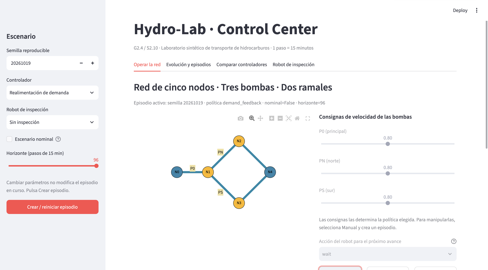

*Figura M-00. Pantalla de bienvenida de Hydro-Lab: el punto de entrada al laboratorio.*

Hydro-Lab es un entorno de aprendizaje, **no un sistema industrial real ni un simulador calibrado para una instalación específica**. Puedes probar decisiones, observar resultados, equivocarte y reiniciar. La idea es descubrir cómo se relacionan la operación física, el consumo de energía, el cumplimiento de la demanda y el costo de obtener información.

### Cómo utilizar este manual

No necesitas programar para comenzar. Las instrucciones te indicarán qué seleccionar, dónde hacer clic y qué observar. Cuando aparezcan términos técnicos, los explicaremos antes de utilizarlos. Los estudiantes con mayor experiencia encontrarán después comparaciones, trazas y experimentos reproducibles.

## 1. Antes de empezar: conoce la red y aprende a decidir

### 1.1 ¿Qué estamos simulando?

Imagina que trabajas en un centro de operaciones. Una red debe transportar hidrocarburos y atender una demanda que cambia a lo largo del día. Para mover el producto dispones de bombas; para decidir cómo utilizarlas debes considerar las condiciones de la red, la energía consumida y el estado de los equipos.

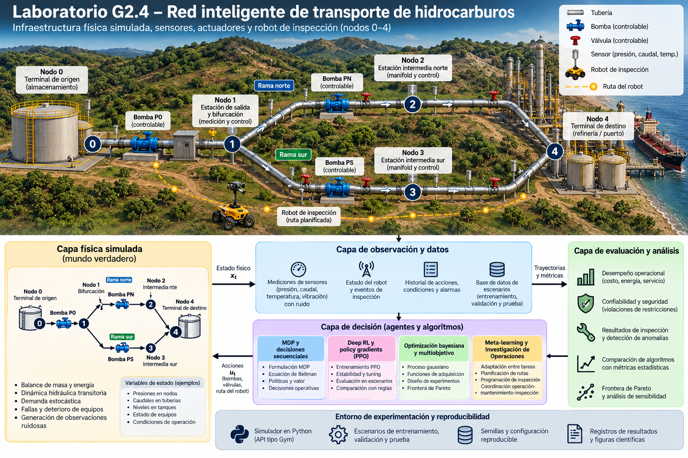

*Figura 1. Arquitectura general de Hydro-Lab G2.4. Úsala como mapa conceptual del sistema; más adelante reconocerás sus componentes en la aplicación.*

El modelo hidráulico contiene **cinco nodos** y **tres bombas**, identificadas como **P0**, **PN** y **PS**. Las bombas impulsan el fluido; las tuberías y los nodos forman la red por la que circula. El simulador calcula cómo responde ese sistema cuando se aplican determinadas órdenes de operación.

Por ahora recuerda solo tres cosas: existe una **red física**, hay una **demanda que debemos atender** y debemos elegir **cómo operar las bombas**. No hace falta conocer todavía las ecuaciones hidráulicas.

### 1.2 ¿Qué significa tomar una decisión?

Tomar una decisión en Hydro-Lab significa elegir las **consignas de operación** de las bombas para el siguiente intervalo de tiempo. Una consigna es una orden que indica cómo debe trabajar un equipo; no es una medición del caudal producido.

Las consignas de P0, PN y PS son números normalizados entre **0,60 y 1,00**. En este laboratorio, `0,60` es el extremo inferior permitido y `1,00` el superior. **No equivalen directamente a metros cúbicos por segundo ni a porcentajes de demanda atendida.** El simulador interpreta esas órdenes y calcula su efecto sobre la red.

Por ejemplo, podrías elegir `P0 = 0,80`, `PN = 0,70` y `PS = 0,90`. Eso no garantiza un resultado bueno: operar más intensamente puede ayudar a satisfacer la demanda, pero también consumir más energía. La cuestión interesante es **qué combinación conviene en cada situación**.

### 1.3 ¿Qué es exactamente un controlador?

Un **controlador** es quien —o aquello que— decide qué órdenes enviar a un sistema para alcanzar un objetivo. Su tarea no consiste en transportar el producto: consiste en **elegir las consignas que recibirán las bombas**.

Piensa en conducir un automóvil. Quieres mantener una velocidad determinada. Observas el velocímetro, comparas la velocidad real con la deseada y decides si debes acelerar o reducir la presión sobre el pedal. Ese proceso de **observar, decidir y actuar** es la idea básica del control.

En Hydro-Lab, el ciclo es semejante:

1. Se dispone de información sobre la red y su operación.
2. El controlador selecciona las consignas de P0, PN y PS.
3. El simulador aplica las consignas y calcula la respuesta física.
4. Se observan los resultados y comienza una nueva decisión.

Un controlador automático no tiene por qué ser una inteligencia artificial que aprende: puede ser una regla programada por un ingeniero. **Automático** significa aquí que el programa elige las consignas durante la simulación; **manual** significa que las eliges tú.

### 1.4 ¿Puedo mover las bombas personalmente?

**Sí. Y lo hemos comprobado en la aplicación.** Para tomar el mando, utiliza esta secuencia cuando llegues a la interfaz:

1. En la barra lateral izquierda, busca **Controlador** y selecciona **Manual**.
2. Pulsa **Crear / reiniciar episodio**. Sin este paso, el episodio anterior conserva su configuración.
3. Abre la pestaña **Operar la red**.
4. Localiza los deslizadores **P0**, **PN** y **PS**. Ahora podrás moverlos entre `0,60` y `1,00`, siempre que el episodio esté activo.
5. Pulsa **▶ Un paso** para aplicar esas consignas durante el siguiente intervalo y observar qué ocurre.

Si los deslizadores aparecen grises o inactivos, **no significa necesariamente que haya un error**: verifica que hayas elegido *Manual* y reiniciado el episodio. Con un controlador automático, los deslizadores se muestran bloqueados porque las consignas las selecciona el algoritmo.

### 1.5 ¿Qué controladores automáticos encontrarás?

No necesitas aprender sus fórmulas ahora. Basta con entender por qué pueden comportarse de manera diferente.

| Opción del controlador | Idea inicial |
|---|---|
| **Manual** | Tú eliges las consignas de las tres bombas. |
| **Realimentación de demanda** | El programa adapta las consignas considerando la demanda y la información operativa disponible. |
| **Consciente de la salud** | También considera estimaciones del estado de salud de las bombas. |
| **Robusto ante la incertidumbre** | Procura evitar decisiones demasiado sensibles a estimaciones inciertas de la salud de los equipos. |

Más adelante podrás comparar sus resultados. **Que una estrategia sea más elaborada no significa que siempre gane.** Ese es precisamente uno de los descubrimientos que ofrece el laboratorio.

### 1.6 ¿Qué ocurre cuando avanzo el tiempo?

Cada **paso** equivale a **15 minutos simulados**. Un episodio de **96 pasos** representa un horizonte máximo de 24 horas, aunque una contingencia puede terminarlo antes.

En cada paso, el simulador aplica las consignas, actualiza el estado de la red y registra indicadores. Entre ellos encontrarás:

- **Demanda no atendida:** producto requerido que no logró entregarse.
- **Energía:** consumo asociado a la operación.
- **Recompensa:** valoración numérica sintética de los resultados, que permite comparar estrategias dentro del laboratorio. No equivale a la utilidad financiera real de una empresa.

No juzgues una decisión por una sola cifra. Una mayor entrega puede exigir más energía; una menor operación puede ahorrar energía y dejar demanda sin atender. **Controlar consiste en comprender esos compromisos.**

### 1.7 ¿Y el robot de inspección?

Además de operar las bombas, Hydro-Lab permite utilizar un robot que se desplaza e inspecciona equipos para obtener información sobre su estado. **Inspeccionar no significa reparar.** Mover el robot y realizar inspecciones tiene costos y consume batería. Más adelante aprenderás a usarlo; por ahora basta con saber que permite explorar otra pregunta: **¿cuándo vale la pena pagar por conocer mejor el sistema?**

### 1.8 Tu primer encuentro con la aplicación

Vamos a comenzar sin complicaciones: el controlador automático tomará las primeras decisiones y tú observarás sus consecuencias. Cuando comprendas la pantalla, volverás para asumir el mando manual.

1. Abre la aplicación siguiendo las instrucciones de la sección 2.
2. En la barra lateral, selecciona **Controlador = Realimentación de demanda** y **Robot de inspección = Sin inspección**.
3. Pulsa **Crear / reiniciar episodio**.
4. Entra en **Operar la red** y pulsa **▶ Un paso**.
5. Busca el contador de pasos, la recompensa acumulada y las métricas del último paso. Has simulado **15 minutos de operación**.

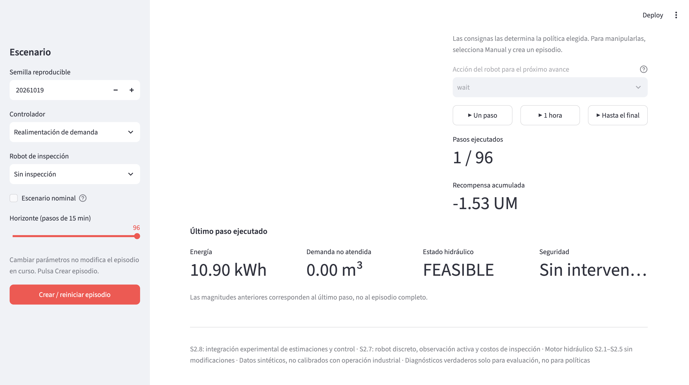

*Figura M-01. Primer paso de operación: un controlador eligió las consignas, la red respondió y el simulador registró las consecuencias.*

**¿Qué acabas de hacer?** No has programado un controlador ni elegido manualmente las consignas: has seleccionado una estrategia automática, ejecutado una transición del sistema y observado el resultado. Ya estás utilizando el laboratorio.

**Tu primera pregunta:** ¿crees que el resultado cambiaría si tú eligieras las consignas? Pronto podrás comprobarlo.

---

## 2. Preparar el entorno y abrir la aplicación

Hydro-Lab se utiliza desde un navegador, pero su simulación se ejecuta localmente. Puedes obtener la versión del curso desde GitHub descargando un ZIP o clonando el repositorio. La aplicación está diseñada para Windows, macOS y Linux y utiliza **Python 3.12**. Para evitar conflictos con otros proyectos, instala sus dependencias en un entorno virtual exclusivo.

### 2.1 Obtener el proyecto desde GitHub

Entra al repositorio **`hydro-lab` de la organización Aprendizaje Profundo** mediante el enlace oficial que te entregue el instructor. Selecciona la versión del curso **G2.4 / S2.10** en *Releases* o *Tags*, cuando esté publicada.

**Opción A — Descargar sin Git (recomendada para principiantes).** En GitHub, abre la versión publicada y descarga su archivo ZIP; descomprímelo en una carpeta de tu elección. Si trabajas desde la rama principal, también puedes utilizar **Code → Download ZIP**, teniendo presente que esa rama puede cambiar.

**Opción B — Clonar con Git (usuarios avanzados).** Copia la URL HTTPS que muestra **Code → HTTPS** y ejecútala en una terminal:

```bash
git clone URL_HTTPS_DEL_REPOSITORIO
cd hydro-lab
```

En la opción A, abre una terminal en la carpeta que acabas de descomprimir. En ambas opciones, los comandos siguientes se ejecutan desde la carpeta principal, que contiene `pyproject.toml` y `dashboard/`.

### 2.2 Crear un entorno virtual e instalar Hydro-Lab

Elige **una sola** de estas alternativas. Ambas aíslan las dependencias del laboratorio.

**Alternativa A — Conda (Windows, macOS o Linux).** Necesitas Conda o Miniconda instalado:

```bash
conda create -n hydro-lab python=3.12 -y
conda activate hydro-lab
python -m pip install -e ".[dev,ui]"
```

Cuando vuelvas a abrir Hydro-Lab otro día, bastará con activar el entorno existente mediante `conda activate hydro-lab`; **no** es necesario crearlo de nuevo.

**Alternativa B — Python `venv` + `pip`.** No necesitas Conda. Debes tener Python 3.12 instalado.

En **Windows (PowerShell)**:

```powershell
py -3.12 -m venv .venv
.\.venv\Scripts\python.exe -m pip install -e ".[dev,ui]"
```

En **macOS o Linux**:

```bash
python3.12 -m venv .venv
source .venv/bin/activate
python -m pip install -e ".[dev,ui]"
```

En Windows utilizamos directamente el Python del entorno para no exigir cambios en la política de ejecución de PowerShell. En macOS y Linux, `source` activa el entorno. Si Python 3.12 no se reconoce, instálalo antes de continuar.

### 2.3 Comprobar la instalación

Desde la carpeta principal del proyecto, ejecuta la suite de pruebas. Si elegiste Conda o activaste `venv` en macOS/Linux:

```bash
python -m pytest
```

Si elegiste `venv` en Windows PowerShell:

```powershell
.\.venv\Scripts\python.exe -m pytest
```

Una ejecución satisfactoria termina sin pruebas fallidas. Si aparece un error, conserva el mensaje para diagnosticarlo; no continúes como si la instalación estuviera verificada.

### 2.4 Abrir Hydro-Lab

En el entorno que acabas de preparar, inicia la aplicación. Con Conda o con `venv` activado:

```bash
python -m streamlit run dashboard/app.py
```

Con `venv` en Windows PowerShell:

```powershell
.\.venv\Scripts\python.exe -m streamlit run dashboard/app.py
```

Streamlit abrirá normalmente el navegador. Si no lo hace, copia la dirección **Local URL** que muestra la terminal; suele ser `http://localhost:8501`, aunque el puerto puede variar. **Mantén abierta la terminal** mientras utilices la aplicación.

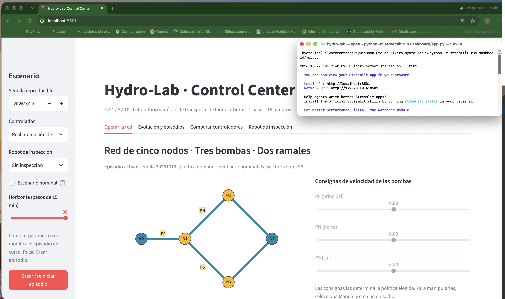

*Figura M-02. La terminal ejecuta Hydro-Lab localmente y el navegador presenta su interfaz de trabajo.*

### 2.5 Comprobar la pantalla inicial y cerrar

Comprueba que aparece **Hydro-Lab · Control Center**, la versión **G2.4 / S2.10** y la indicación **1 paso = 15 minutos**. Verás también la barra lateral de configuración y la pestaña **Operar la red**.

Cuando termines, vuelve a la terminal y pulsa **Ctrl+C**. Cerrar únicamente la pestaña del navegador no necesariamente detiene Streamlit.

## 3. Orientarte: el mapa de la aplicación

Hydro-Lab tiene **una barra lateral** y **cuatro pestañas**. La barra lateral fija las condiciones del episodio; las pestañas sirven para operar, analizar, comparar y observar al robot.

| Zona | Rótulo exacto | Para qué sirve |
|---|---|---|
| Barra lateral | Escenario | Configurar semilla, controlador, robot, modo nominal y horizonte |
| Pestaña 1 | Operar la red | Avanzar la simulación y, en modo manual, ajustar bombas y robot |
| Pestaña 2 | Evolución y episodios | Inspeccionar gráficos, métricas, trazas y descargar resultados |
| Pestaña 3 | Comparar controladores | Ejecutar dos experimentos pareados desde la interfaz |
| Pestaña 4 | Robot de inspección | Revisar ubicación, batería, eventos, estimaciones e incertidumbre |

Si la barra lateral no aparece, expándela desde el control de Streamlit en el borde izquierdo; el icono puede variar con la versión.

**FIGURA M-03 — Mapa general**  
**Archivo:** `imagenes/M-03-pantalla-general.png`  
**Qué debe mostrar la figura:** aplicación recién abierta, con barra lateral expandida y las cuatro pestañas visibles.  
**Pie:** *Una configuración compartida; cuatro formas de explorar el mismo episodio.*


## 4. La barra lateral: cinco decisiones antes de comenzar

**Semilla reproducible.** Es un número que permite repetir una secuencia pseudoaleatoria. Para comparaciones justas, conserva la misma semilla y modifica una sola decisión a la vez. La semilla predeterminada es **20261019**.

**Controlador.** Hay cinco opciones: **Realimentación de demanda**, **Control sensible a salud**, **Control robusto a ruido**, **Velocidad constante** y **Manual**. El controlador determina cómo se eligen las consignas hidráulicas.

**Robot de inspección.** Hay cuatro opciones: **Sin inspección**, **Control manual**, **Priorizar incertidumbre** e **Inspección costo-consciente**. Este selector es independiente del controlador hidráulico.

**Escenario nominal.** Al activarlo se utilizan exógenas nominales; **no elimina el modelo de fallas**. No equivale a «sin riesgos».

**Horizonte (pasos de 15 min).** Puede ir de **1 a 96**. Un día completo tiene 96 pasos. El horizonte limita la duración máxima, pero una contingencia puede terminar antes el episodio.

**Regla fundamental:** cambiar cualquiera de estos selectores **no altera el episodio que ya está corriendo**. Para aplicar la configuración nueva, pulsa **Crear / reiniciar episodio**. Eso reemplaza el episodio activo; descarga los datos antes si deseas conservarlos.

**FIGURA M-04 — Configuración del episodio**  
**Archivo:** `imagenes/M-04-barra-lateral.png`  
**Qué debe mostrar la figura:** barra lateral completa con los cinco controles y el botón de creación; usa una ventana suficientemente alta o dos capturas si no cabe.  
**Pie:** *El episodio comienza con una decisión de diseño experimental.*

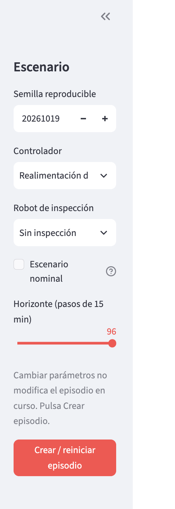

### Antes de cada recorrido: ficha de configuración

Anota: **semilla**, **controlador**, **política del robot**, **escenario nominal sí/no**, **horizonte**. Si cambias alguno, crea un episodio nuevo. Si vas a comparar dos recorridos, guarda ambas fichas.

## 5. Operar la red: bombas, acciones y tiempo

En **Operar la red** encontrarás un esquema con **cinco nodos** y tres bombas identificadas como **P0** (principal), **PN** (norte) y **PS** (sur). Los nodos `N0`–`N4` pertenecen a la red hidráulica; las estaciones `BASE`, `P0`, `PN` y `PS` del robot son **otro grafo**, de acceso logístico. No confundas ambos mapas.

Las tres consignas de velocidad van de **0,60 a 1,00**. Solo puedes mover sus deslizadores si elegiste el controlador **Manual** y el episodio no ha terminado. En los demás controladores la política selecciona las consignas y los deslizadores aparecen deshabilitados.

| Botón | Acción real |
|---|---|
| **▶ Un paso** | Avanza hasta un paso adicional de 15 minutos |
| **▶ 1 hora** | Avanza hasta cuatro pasos adicionales |
| **▶ Hasta el final** | Intenta ejecutar todos los pasos restantes del horizonte |

**Atención:** estos botones **añaden** pasos; no llevan el contador a 1, 4 o 96 desde cero. Si el episodio termina por contingencia, pueden ejecutarse menos pasos.

En la parte inferior verás métricas del **último paso**: energía en kWh, demanda no atendida en m³, estado hidráulico y seguridad. En cambio, **Recompensa acumulada** agrega el resultado de la trayectoria ejecutada.

**FIGURA M-05 — Controles de operación**  
**Archivo:** `imagenes/M-05-bombas-y-avance.png`  
**Qué debe mostrar la figura:** pestaña Operar la red, con los tres deslizadores, selector de acción robótica y los tres botones de avance.  
**Pie:** *Las decisiones hidráulicas y robóticas se ejecutan al avanzar el reloj.*

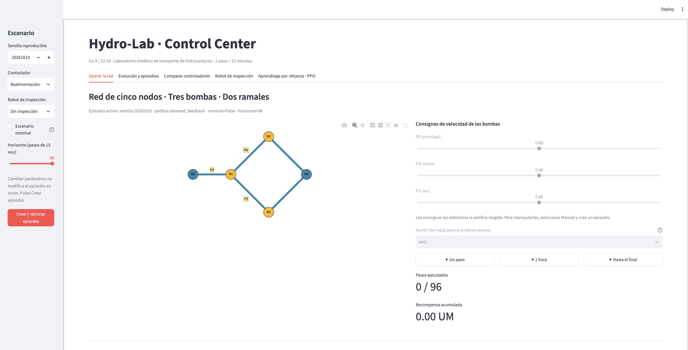

## 6. Recorrido guiado A: operar un día completo

**Objetivo:** completar un episodio sin intervención manual, identificar las principales métricas y guardar los resultados.

**Configuración:** semilla `20261019`; controlador **Realimentación de demanda**; robot **Sin inspección**; escenario nominal **desactivado**; horizonte **96**. Pulsa **Crear / reiniciar episodio**.

1. En **Operar la red**, pulsa **▶ Un paso**. Comprueba **1 / 96**.
2. Pulsa **▶ 1 hora**. Comprueba el nuevo contador: normalmente **5 / 96**.
3. Pulsa **▶ Hasta el final**. Espera a que termine la ejecución.
4. Observa el aviso **Horizonte completado (truncado)** o **Episodio terminado por contingencia**. Ambos son finales válidos del episodio, pero **no significan lo mismo**.
5. Abre **Evolución y episodios**. Examina inventarios, demanda, recompensa, energía y demanda no atendida.
6. Pulsa **Descargar episodio JSON**. Guarda el archivo para poder recuperar la trayectoria.

**Comprueba:** puedes explicar en una frase si el episodio llegó al horizonte y qué ocurrió con la demanda no atendida.

**Prueba tú:** repite con **Escenario nominal** activado, usando la misma semilla. ¿Cambian las curvas? ¿Por qué una comparación de un único episodio no prueba que una estrategia sea superior?

**FIGURA M-06 — Episodio completo**  
**Archivo:** `imagenes/M-06-episodio-finalizado.png`  
**Qué debe mostrar la figura:** Operar la red después de finalizar el episodio, con contador, recompensa y mensaje de cierre visibles.  
**Pie:** *Un episodio puede terminar por horizonte o por contingencia; distingue ambos casos.*

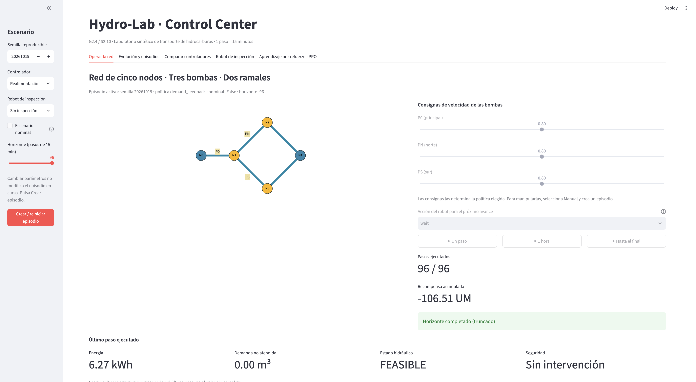

## 7. Evolución y episodios: leer sin confundirse

Esta pestaña aparece vacía al inicio y pide ejecutar al menos un paso. Después muestra un selector **Inspeccionar paso**, gráficos temporales y un resumen del episodio.

**Inventarios observados (m³).** Siguen los volúmenes observados en dos nodos de referencia. Son observaciones del sistema, no un dibujo de todo el estado físico.

**Demanda observada (m³/s).** Representa una tasa; **no** es el mismo tipo de magnitud que la demanda no atendida expresada en m³ por paso.

**Recompensa acumulada (UM).** Integra la evaluación de las decisiones hasta el instante considerado. Una cifra menos negativa suele indicar un resultado mejor **bajo la función de recompensa del simulador**, no necesariamente bajo todos los criterios de ingeniería.

**Energía (kWh) y déficit (m³) por paso.** El gráfico comparte un eje visual para magnitudes con **unidades y escalas distintas**. No compares alturas como si fueran unidades equivalentes.

El resumen inferior muestra **Energía total**, **Demanda no atendida total**, **Intervenciones** y **Error máx. masa**. El error de balance es una comprobación numérica; no es una medida de calidad de la política.

**FIGURA M-07 — Evolución temporal**  
**Archivo:** `imagenes/M-07-graficos-evolucion.png`  
**Qué debe mostrar la figura:** pestaña Evolución y episodios tras ejecutar varios pasos, mostrando selector y los cuatro gráficos; si no caben, compón dos capturas sin alterar datos.  
**Pie:** *La trayectoria importa: un resultado final no cuenta toda la historia.*

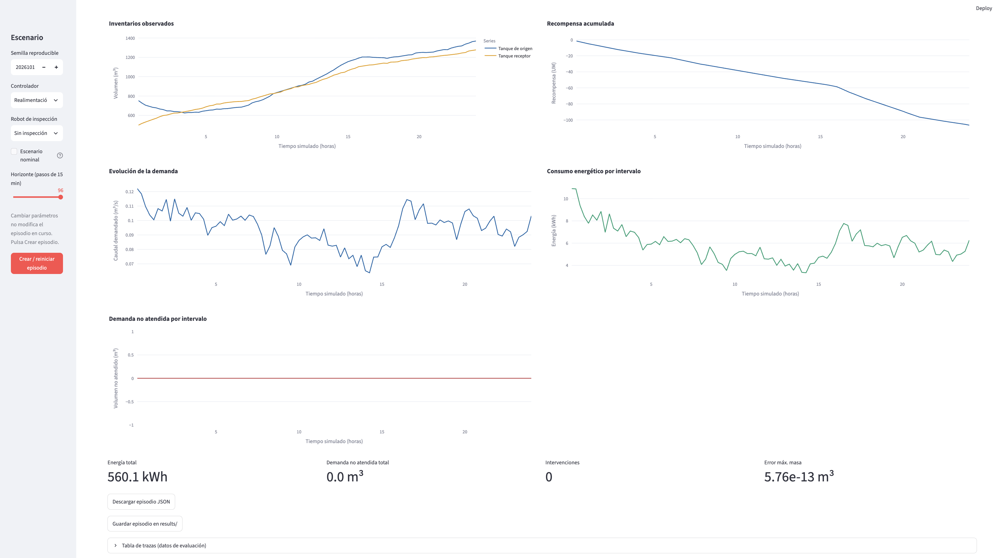

**FIGURA M-08 — Métricas y exportación**  
**Archivo:** `imagenes/M-08-metricas-y-descarga.png`  
**Qué debe mostrar la figura:** parte inferior de Evolución y episodios con cuatro métricas, botones de descarga y guardar, y expansor de trazas.  
**Pie:** *Medir, registrar y conservar el experimento es parte del aprendizaje.*

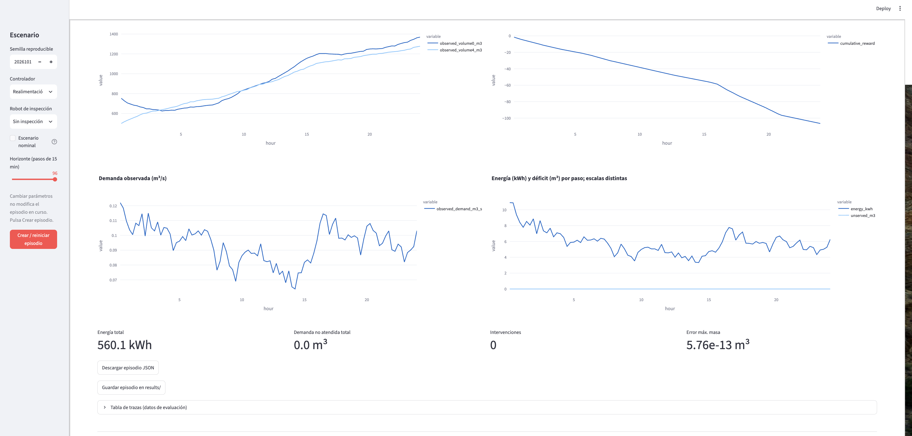

### La tabla de trazas

Abre **Tabla de trazas (datos de evaluación)**. Cada fila corresponde a un paso. Puedes inspeccionar, entre otros, la hora, la acción ejecutada, energía, demanda no atendida y recompensa. **No confundas la acción solicitada con la ejecutada:** la lógica de seguridad puede intervenir. Algunas columnas son diagnósticos de evaluación y no información accesible a las políticas.

**FIGURA M-09 — Una fila de evidencia**  
**Archivo:** `imagenes/M-09-tabla-trazas.png`  
**Qué debe mostrar la figura:** expansor abierto, con al menos tres filas y columnas de tiempo, acción y resultados visibles.  
**Pie:** *Una decisión defendible deja un registro verificable.*

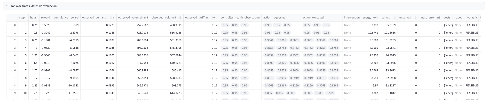

## 8. Recorrido guiado B: tomar el mando manual

**Objetivo:** comprobar que una consigna modifica la evolución, sin atribuir automáticamente causalidad a un solo cambio.

1. En la barra lateral elige **Controlador = Manual** y **Robot = Sin inspección**.
2. Conserva la semilla y el horizonte. Pulsa **Crear / reiniciar episodio**.
3. En **Operar la red**, fija P0, PN y PS en **0,80**. Pulsa **▶ Un paso**.
4. Anota **Energía**, **Demanda no atendida** y **Recompensa acumulada**.
5. Cambia **solo PN** a **0,90**. Pulsa **▶ Un paso**.
6. En **Evolución y episodios**, usa **Inspeccionar paso** para comparar los pasos 1 y 2; abre la tabla de trazas.

**¿Qué significa?** Una consigna mayor no implica necesariamente una recompensa mejor. Puede elevar el consumo energético o encontrar restricciones físicas. Además, la demanda y el estado también evolucionan: no interpretes la diferencia entre dos instantes como un experimento controlado perfecto.

**Prueba tú (comparación más justa):** reinicia con la misma semilla y repite dos episodios manuales idénticos salvo por una consigna inicial. Conserva ambas trazas.

**FIGURA M-10 — Bombas bajo control manual**  
**Archivo:** `imagenes/M-10-control-manual.png`  
**Qué debe mostrar la figura:** selector Manual activo (o visible junto al panel) y deslizadores habilitados con PN en 0,90.  
**Pie:** *Control manual: la persona propone las consignas; el sistema impone la física y la seguridad.*

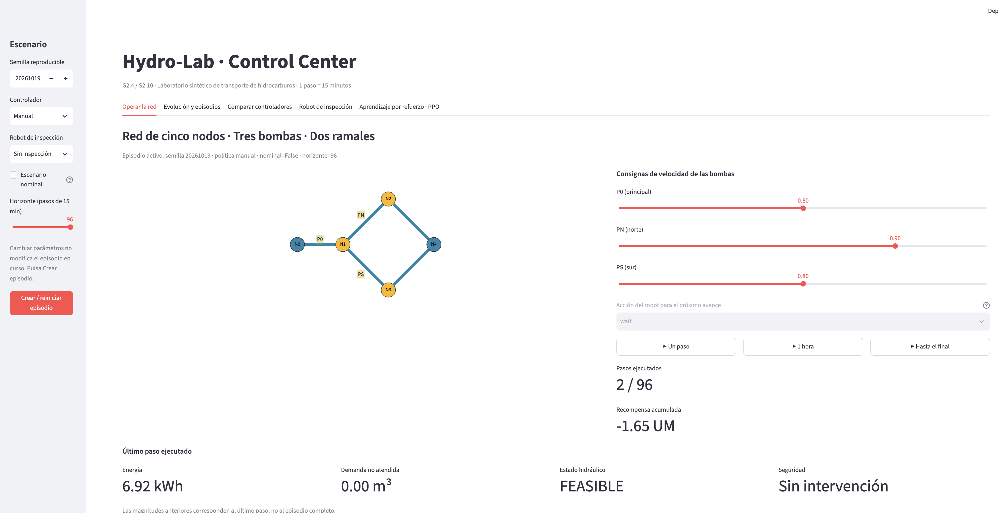

## 9. Recorrido guiado C: enfrentar controladores

**Objetivo:** observar que «más complejo» no significa «mejor en todas las condiciones».

En **Comparar controladores** hay **dos experimentos distintos**, conservados por razones históricas:

**Experimento 1 — Constante vs. realimentación.** El título dice **Experimento pareado: constante vs. realimentación**. Selecciona **Número de semillas pareadas = 5**, conserva **Primera semilla = 1000** y pulsa **Ejecutar benchmark**. La tabla compara ambas políticas bajo las mismas semillas. La métrica **Diferencia media pareada de recompensa** es **realimentación menos constante**. Positivo favorece a realimentación en ese conjunto de semillas.

**Experimento 2 — S2.8: observación activa.** Debajo encontrarás **S2.8 · Experimento factorial de observación activa**. Selecciona **Semillas S2.8 = 5**, conserva **Primera semilla S2.8 = 2000** y pulsa **Ejecutar comparación S2.8**. Se evalúan cuatro brazos: control por demanda y sensible a salud, cada uno con robot apagado o autónomo. El indicador de valor neto resta los costos del robot.

**Importante:** el experimento completo **S2.10** (control robusto e inspección costo-consciente) **no tiene botón propio en esta pestaña**. Se ejecuta por Terminal en la sección 15. No interpretes los botones S2.8 como si ejecutaran S2.10.

**FIGURA M-11 — Benchmark pareado**  
**Archivo:** `imagenes/M-11-benchmark-controladores.png`  
**Qué debe mostrar la figura:** primera sección de Comparar controladores con cinco semillas, tabla de resultados y diferencia media.  
**Pie:** *La comparación pareada mantiene comunes las semillas y cambia la política.*

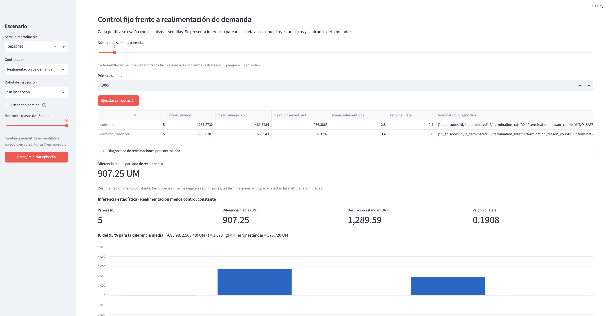

**FIGURA M-12 — Comparación de observación activa**  
**Archivo:** `imagenes/M-12-experimento-s28.png`  
**Qué debe mostrar la figura:** segunda sección con los cuatro brazos y el indicador de valor neto.  
**Pie:** *Obtener información también consume recursos.*

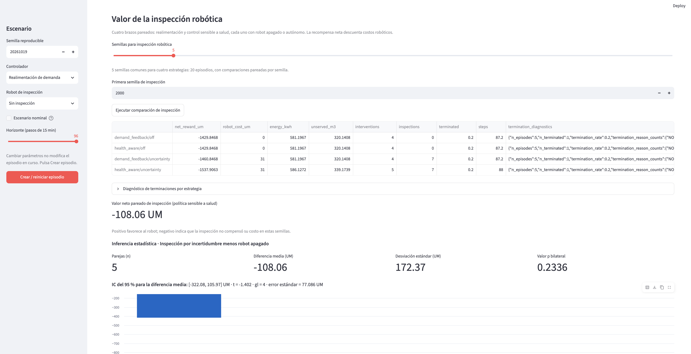

## 10. El robot: un segundo sistema de decisiones

El robot tiene un mapa de accesos propio: **BASE ↔ P0 ↔ PN** y **P0 ↔ PS**. No puede saltar de BASE a PN o PS. Cada paso hidráulico permite **una acción robótica**, ejecutada después de la transición hidráulica. Una inspección **mide** con ruido y actualiza una estimación; **no repara** una bomba.

| Acción | Qué hace | Costo | Batería |
|---|---|---:|---:|
| `wait` | Espera en la estación actual | 0 UM | 0 |
| `move_BASE`, `move_P0`, `move_PN`, `move_PS` | Se mueve solo a estación vecina | 1 UM | −4 |
| `inspect` | Inspecciona la bomba de la estación actual | 3 UM | −8 |

Batería inicial: **100**. Desde BASE, `inspect` no inspecciona ninguna bomba. Un movimiento imposible registra `BLOCKED_ROUTE` y no consume batería ni costo. El robot no se mueve automáticamente cuando su política es **Control manual**: tú debes seleccionar una acción antes de avanzar.

**FIGURA M-13 — Estado inicial del robot**  
**Archivo:** `imagenes/M-13-robot-inicial.png`  
**Qué debe mostrar la figura:** pestaña Robot de inspección al iniciar un episodio con robot manual, mostrando BASE, batería 100, 0 inspecciones, 0 UM y tabla de estimaciones.  
**Pie:** *La exploración comienza con información incompleta y una batería finita.*

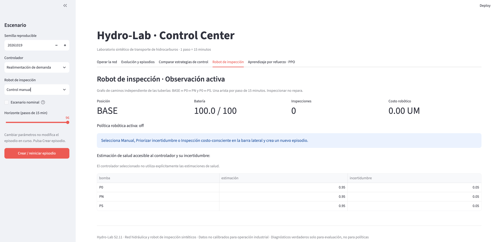

## 11. Recorrido guiado D: primera inspección

**Objetivo:** experimentar el costo de obtener información.

1. En la barra lateral, deja el controlador hidráulico en **Realimentación de demanda** y cambia **Robot de inspección = Control manual**.
2. Pulsa **Crear / reiniciar episodio**. Comprueba en **Robot de inspección**: posición **BASE**, batería **100**, inspecciones **0**, costo **0 UM**.
3. Vuelve a **Operar la red**. En **Acción del robot para el próximo avance**, elige **`move_P0`**. Pulsa **▶ Un paso**.
4. Abre **Robot de inspección**: posición **P0**, batería **96**, costo **1 UM**.
5. Vuelve a **Operar la red**. Elige **`inspect`** y pulsa **▶ Un paso**.
6. En la pestaña del robot, comprueba: batería **88**, **1 inspección**, costo total **4 UM**. En la tabla de eventos busca `INSPECTED` y una medición.
7. Observa **estimación** e **incertidumbre** para P0. La medida es ruidosa y puede modificar la creencia del sistema.

**La pregunta importante:** ¿valía la pena gastar 4 UM para llegar e inspeccionar P0? No puedes responder mirando solo el costo: necesitas preguntar si la información mejora decisiones posteriores.

**FIGURA M-14 — Inspección ejecutada**  
**Archivo:** `imagenes/M-14-robot-inspeccion-p0.png`  
**Qué debe mostrar la figura:** robot en P0 después de inspeccionar, con batería 88, una inspección, costo 4 UM y evento `INSPECTED`.  
**Pie:** *Una observación adicional puede reducir incertidumbre, pero nunca es gratuita.*

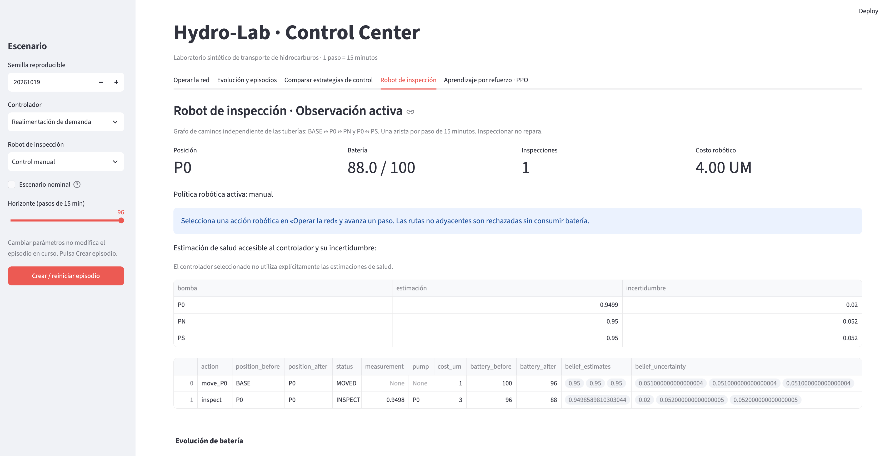

## 12. Recorrido guiado E: una ruta bloqueada

**Objetivo:** distinguir una acción rechazada de una falla de la aplicación.

1. Crea un episodio nuevo con **Robot = Control manual**.
2. Desde BASE, en **Operar la red**, selecciona **`move_PS`** y pulsa **▶ Un paso**.
3. Abre **Robot de inspección**. En la tabla de eventos busca **`BLOCKED_ROUTE`**.
4. Comprueba que la posición continúa en **BASE** y la batería en **100**.
5. Regresa a Operar la red, elige **`move_P0`**, avanza un paso; después elige **`move_PS`** y avanza otro.
6. Comprueba que ahora el robot está en **PS**, con batería **92** y costo acumulado **2 UM** (si no hubo otras acciones).

**¿Qué significa?** El sistema no permite teletransportarse: el grafo de acceso impone una restricción. El tiempo de viaje también tiene un costo de oportunidad, porque cada movimiento consume un paso.

**FIGURA M-15 — Movimiento rechazado**  
**Archivo:** `imagenes/M-15-ruta-bloqueada.png`  
**Qué debe mostrar la figura:** evento `BLOCKED_ROUTE`, posición BASE y batería 100 visibles.  
**Pie:** *Una restricción bien modelada evita movimientos físicamente imposibles.*

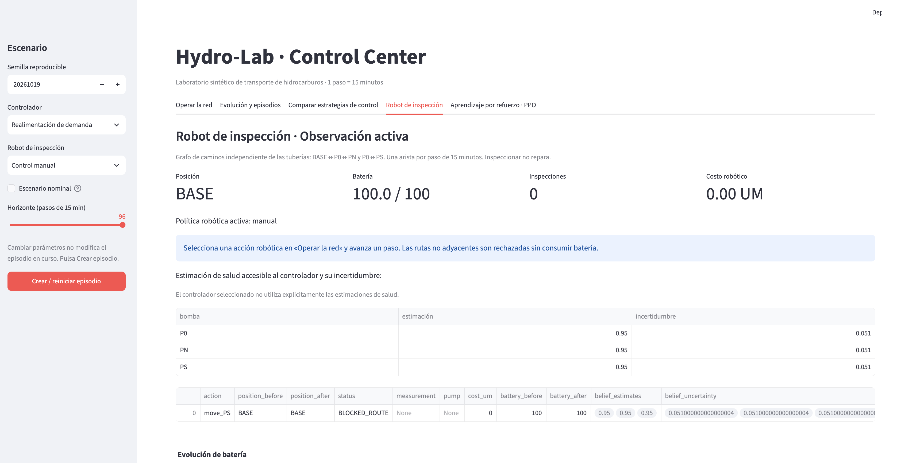

## 13. Recorrido guiado F: dejar que el robot decida

**Objetivo:** comparar dos estrategias autónomas sin confundirlas con aprendizaje por refuerzo.

**Política Priorizar incertidumbre.** En la barra lateral elige **Robot = Priorizar incertidumbre**, crea un episodio y ejecuta **▶ Hasta el final**. En la pestaña del robot, registra inspecciones, costo, batería y evolución de incertidumbre.

**Política Inspección costo-consciente.** Con **la misma semilla, controlador hidráulico y horizonte**, cambia **Robot = Inspección costo-consciente**, crea un episodio nuevo y ejecuta hasta el final. Registra las mismas métricas.

La segunda política puede **esperar** si la incertidumbre ponderada por riesgo no supera un umbral, si falta batería o si ya realizó tres inspecciones. Es una **heurística**, no una política PPO entrenada ni un cálculo exacto del valor económico de la información.

**Advertencia sobre la interfaz:** el texto explicativo de la pestaña Robot de inspección conserva una descripción genérica de la heurística autónoma, y el aviso sobre el uso explícito de salud menciona `health_aware`; para S2.10, consulta el selector activo y los eventos. **No tomes esos textos heredados como una descripción exhaustiva de `health_robust` o `value`.**

**FIGURA M-16 — Robot autónomo y eventos**  
**Archivo:** `imagenes/M-16-robot-autonomo.png`  
**Qué debe mostrar la figura:** pestaña Robot de inspección después de un episodio con política costo-consciente, mostrando métricas, tabla de eventos y, si es posible, evolución de batería.  
**Pie:** *A veces la mejor acción informativa es esperar.*

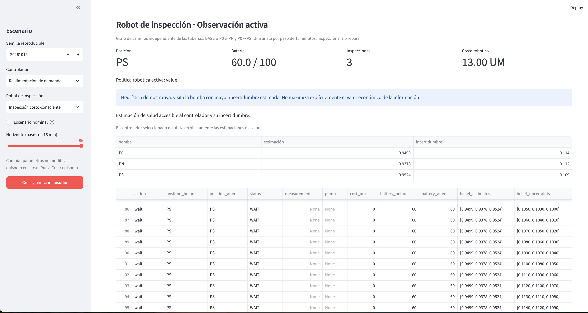

**FIGURA M-17 — Salud estimada e incertidumbre**  
**Archivo:** `imagenes/M-17-salud-incertidumbre.png`  
**Qué debe mostrar la figura:** tabla de estimaciones y gráficas de salud e incertidumbre después de varias acciones robóticas.  
**Pie:** *El controlador trabaja con creencias; la salud verdadera permanece oculta a la política.*

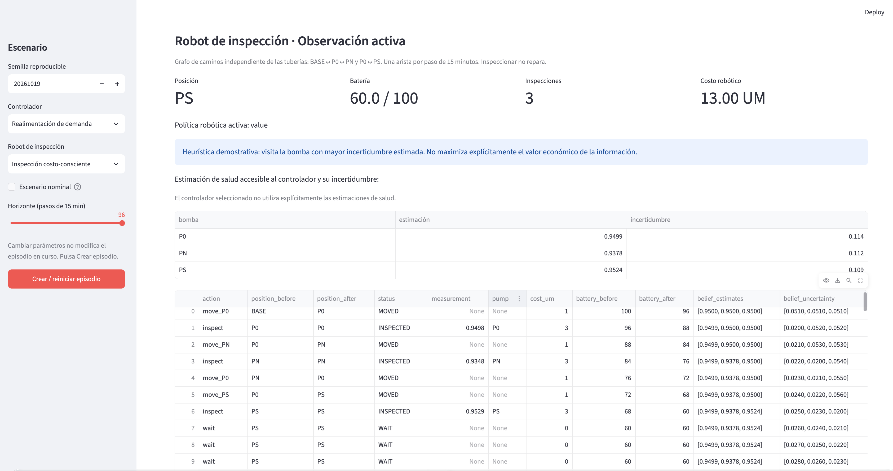

## 14. Guardar, recuperar y comunicar resultados

En **Evolución y episodios**, **Descargar episodio JSON** guarda un archivo mediante el navegador; **Guardar episodio en results/** intenta escribir el reporte en la carpeta `results/` relativa al directorio desde el que se lanzó la aplicación. Si hay un error de permisos, aparecerá un mensaje.

En **Comparar controladores** puedes descargar el benchmark en JSON. **Los botones de descarga no sustituyen la ficha de configuración**: guarda también semilla, controlador, robot, nominal y horizonte.

Para entregar un resultado académico, escribe un párrafo con: **pregunta**, **configuración**, **intervención**, **métrica observada**, **interpretación**, **limitación**. Ejemplo: «Con semilla X y horizonte Y comparé dos políticas robóticas. En esta ejecución una realizó menos inspecciones; esto no prueba superioridad general».

**FIGURA M-18 — Evidencia lista para guardar**  
**Archivo:** `imagenes/M-18-exportacion-json.png`  
**Qué debe mostrar la figura:** botones Descargar episodio JSON y Guardar episodio en results/; opcionalmente la carpeta Descargas mostrando el archivo creado.  
**Pie:** *Una experiencia se convierte en experimento cuando se puede reproducir.*

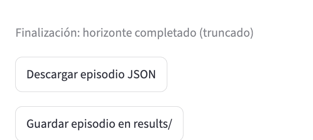

## 15. Taller opcional avanzado: comparación S2.10 por Terminal

Esta sección es **opcional** para estudiantes sin experiencia en Python. El experimento de S2.10 compara cuatro brazos en tres regímenes sintéticos, con semillas comunes. **No aparece como botón específico en Streamlit**.

Desde la carpeta del proyecto y con el entorno activo:

```bash
python examples/compare_s210.py --seeds 10 --output results/s210_manual_clase
```

Usa una carpeta de salida nueva. Se generan:

| Archivo | Contenido |
|---|---|
| `summary_s210.md` | Resumen legible de los cuatro brazos y los tres regímenes |
| `comparison_s210.json` | Resultados estructurados, incluidos efectos pareados |
| `episodes_s210.csv` | Datos tabulares de episodios |

Los brazos son `health_aware/off`, `health_aware/uncertainty`, `health_robust/off` y `health_robust/value`. Los regímenes son `baseline`, `degraded` y `accelerated_wear`. La diferencia impresa por el programa es **recompensa de `health_robust/value` menos recompensa de `health_robust/off`**; no compara directamente las dos políticas robóticas manteniendo el mismo controlador hidráulico en todos los casos.

**Ejemplo de lectura de una ejecución validada:** en una comparación previa, el efecto pareado medio fue aproximadamente **+109,86 UM** en `baseline`, **−16,53 UM** en `degraded` y **+1,43 UM** en `accelerated_wear`. Estos son resultados de una corrida particular, no valores garantizados ni evidencia de superioridad universal.

**FIGURA M-19 — Experimento reproducible**  
**Archivo:** `imagenes/M-19-terminal-comparacion-s210.png`  
**Qué debe mostrar la figura:** Terminal mostrando el comando, el directorio de salida y las tres diferencias pareadas; evita mostrar información personal.  
**Pie:** *Las políticas se comparan bajo las mismas semillas, pero los resultados siguen siendo descriptivos.*

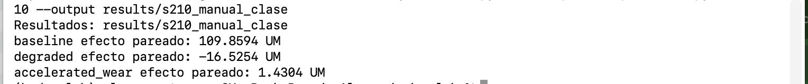

## 16. Solución de problemas: diagnóstico rápido

| Síntoma | Qué revisar | Qué hacer |
|---|---|---|
| `conda: command not found` | Conda no está disponible en esa terminal | Abre una terminal configurada para conda o solicita apoyo al docente |
| `No module named streamlit` | Entorno equivocado o dependencia ausente | Activa `hydro-lab`; instala `python -m pip install -e ".[dev,ui]"` |
| `No such file or directory` al ejecutar | Carpeta de proyecto equivocada | Verifica que exista `dashboard/app.py` en el directorio actual |
| El navegador no muestra la app | Servidor aún iniciando o URL distinta | Usa la Local URL de Terminal; comprueba que el proceso siga activo |
| Los deslizadores están bloqueados | Controlador no manual o episodio finalizado | Selecciona Manual en barra lateral y crea un episodio nuevo |
| Cambio un selector y no pasa nada | El episodio conserva su configuración inicial | Pulsa Crear / reiniciar episodio (guarda antes la trayectoria) |
| No veo gráficos | Aún no hay pasos ejecutados | Ejecuta ▶ Un paso en Operar la red |
| No puedo mover el robot | Política robótica distinta de Manual | Elige Control manual **en Robot de inspección** y reinicia |
| `BLOCKED_ROUTE` | Destino no vecino | Pasa primero por P0 si sales de BASE |
| `NO_PUMP_AT_STATION` | Inspección desde BASE | Muévete a P0, PN o PS antes de inspeccionar |
| El episodio termina antes de 96 | Contingencia o horizonte menor | Lee el mensaje final y revisa el horizonte |
| Recompensa negativa | Costos y penalizaciones | No es un error por sí mismo; compara junto con energía y servicio |
| No se guarda en `results/` | Ruta o permisos | Descarga el JSON desde el navegador y verifica el directorio de ejecución |
| Error al reutilizar salida S2.10 | El experimento evita sobrescrituras | Elige otro nombre de carpeta con `--output` |

**FIGURA M-20 — Un mensaje que enseña**  
**Archivo:** `imagenes/M-20-aviso-o-error-real.png`  
**Qué debe mostrar la figura:** un mensaje real y pedagógicamente útil (por ejemplo, aviso de episodio finalizado o panel que solicita ejecutar un paso). No provoques errores artificiales ni muestres datos privados.  
**Pie:** *Los mensajes de estado orientan el siguiente paso.*


## 17. Tres misiones para experimentar sin instrucciones

### Misión 1 — ¿Quién toma las decisiones?

Con la misma semilla, compara **Manual** y **Realimentación de demanda**. Registra qué variables cambian y cuáles permanecen fijadas. Explica por qué dos episodios con el mismo inicio pueden evolucionar de manera diferente.

### Misión 2 — ¿Cuánto cuesta conocer mejor la red?

Desde BASE, calcula el costo mínimo de desplazarse hasta PN e inspeccionar: **dos movimientos + una inspección = 5 UM**, y **16 unidades de batería**. Verifícalo en el simulador. Luego explica por qué un robot autónomo podría decidir no inspeccionar.

### Misión 3 — ¿Una política más sofisticada es siempre mejor?

Compara **Priorizar incertidumbre** e **Inspección costo-consciente** con semilla común. Registra inspecciones, costo y recompensa neta. Formula una explicación de un resultado desfavorable sin llamarlo «fracaso del algoritmo».

**Entrega sugerida:** una página por equipo, con una captura de evidencia, la configuración completa, dos métricas y una conclusión que reconozca sus límites.

## 18. Diez reglas de bolsillo

1. Un paso representa **15 minutos**.
2. Un día máximo equivale a **96 pasos**.
3. **▶ 1 hora** agrega hasta cuatro pasos, no reinicia el reloj.
4. **Crear / reiniciar episodio** reemplaza la sesión actual.
5. Cambiar la barra lateral no modifica una sesión ya creada.
6. El controlador hidráulico y la política robótica son **dos elecciones diferentes**.
7. Las estaciones del robot no son los nodos hidráulicos.
8. Inspeccionar **no repara**; produce una medición ruidosa.
9. Una recompensa negativa no equivale a un error de software.
10. Una comparación de pocas semillas **no demuestra** superioridad general.

## 19. Registro y especificación de figuras

**Convención editorial.** Las figuras utilizan nombres de archivo estables dentro de `imagenes/`. Para actualizar una captura, conserva su nombre y documenta la configuración del episodio que representa.

**Recomendaciones:** usa siempre la misma resolución de ventana cuando sea posible; deja visible el título de la pestaña; evita capturas demasiado pequeñas; no recortes etiquetas importantes; no dibujes datos ficticios; si un valor no coincide con el ejemplo, conserva el valor real y avísanos. Para composiciones, usa únicamente fragmentos de capturas auténticas y marca la composición como tal.

| Orden | Archivo exacto | Momento de captura |
|---:|---|---|
| 01 | `M-01-primer-paso.png` | Después del primer paso |
| 02 | `M-02-terminal-y-aplicacion.png` | Al abrir la aplicación |
| 03 | `M-03-pantalla-general.png` | Pantalla inicial completa |
| 04 | `M-04-barra-lateral.png` | Configuración antes de iniciar |
| 05 | `M-05-bombas-y-avance.png` | Controles de Operar la red |
| 06 | `M-06-episodio-finalizado.png` | Después de Hasta el final |
| 07 | `M-07-graficos-evolucion.png` | Evolución con varios pasos |
| 08 | `M-08-metricas-y-descarga.png` | Métricas totales y descarga |
| 09 | `M-09-tabla-trazas.png` | Tabla de trazas abierta |
| 10 | `M-10-control-manual.png` | Bombas manuales habilitadas |
| 11 | `M-11-benchmark-controladores.png` | Primer benchmark completado |
| 12 | `M-12-experimento-s28.png` | Comparación S2.8 completada |
| 13 | `M-13-robot-inicial.png` | Robot en BASE sin acciones |
| 14 | `M-14-robot-inspeccion-p0.png` | Después de mover e inspeccionar P0 |
| 15 | `M-15-ruta-bloqueada.png` | Tras intento BASE→PS |
| 16 | `M-16-robot-autonomo.png` | Política costo-consciente ejecutada |
| 17 | `M-17-salud-incertidumbre.png` | Gráficas de creencias |
| 18 | `M-18-exportacion-json.png` | Panel de exportación |
| 19 | `M-19-terminal-comparacion-s210.png` | Script S2.10 terminado |
| 20 | `M-20-aviso-o-error-real.png` | Aviso real de la interfaz |

**Nota editorial:** las figuras M-02 a M-05 documentan diferentes aspectos de la apertura y configuración de la aplicación.

## 20. Glosario mínimo

**Acción:** decisión que se aplica en un paso. **Controlador:** regla que decide consignas. **Episodio:** trayectoria desde el reinicio hasta el final. **Horizonte:** máximo de pasos. **Observación:** información disponible, posiblemente incompleta o ruidosa. **Estado latente:** información interna del simulador no accesible directamente a la política. **Recompensa:** valoración numérica de la trayectoria según una función definida. **Semilla:** valor que controla reproducibilidad pseudoaleatoria. **UM:** unidad monetaria sintética del simulador. **Política:** regla para elegir acciones. **Inspección:** medición ruidosa de una bomba, no reparación. **PPO:** algoritmo de aprendizaje por refuerzo que será materia de la fase posterior del curso; **no está implementado en este manual S2.10**.

---

**Control de edición:** Manual S2.10, versión documental V2-0 — texto maestro Markdown con referencias a imágenes reales. Referencia funcional: `dashboard/app.py`, `src/hydro_lab/robot.py`, `docs/S2.10_CONTROL_ROBUSTO_Y_OBSERVACION_COSTO_CONSCIENTE.md` y `examples/compare_s210.py` de S2.10. Mantener esta edición histórica; las capturas integradas darán lugar a una nueva generación documental, sin sobrescribirla.
