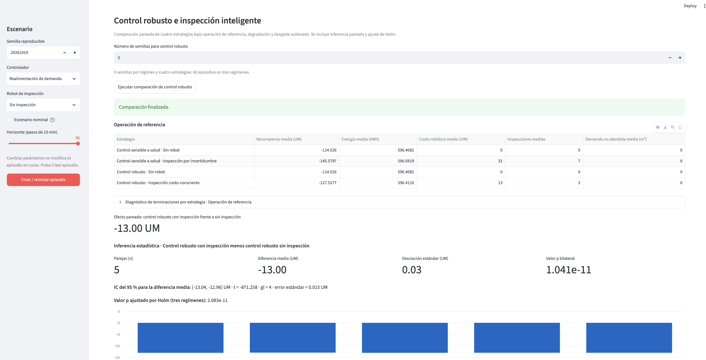
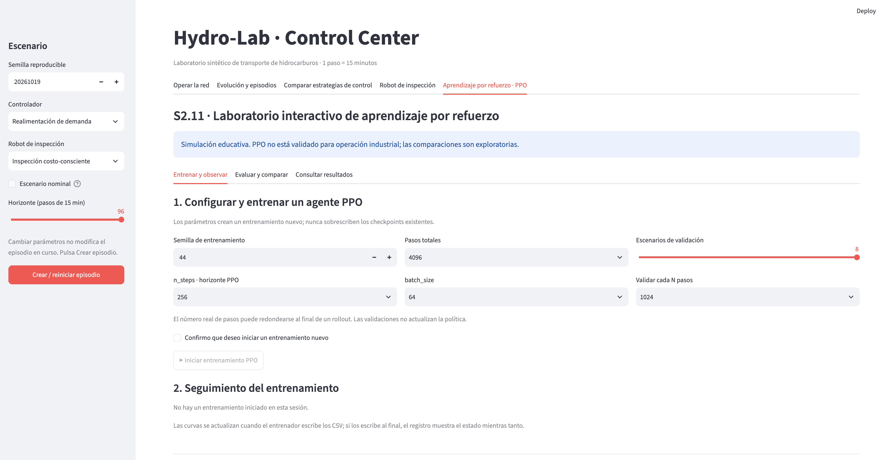
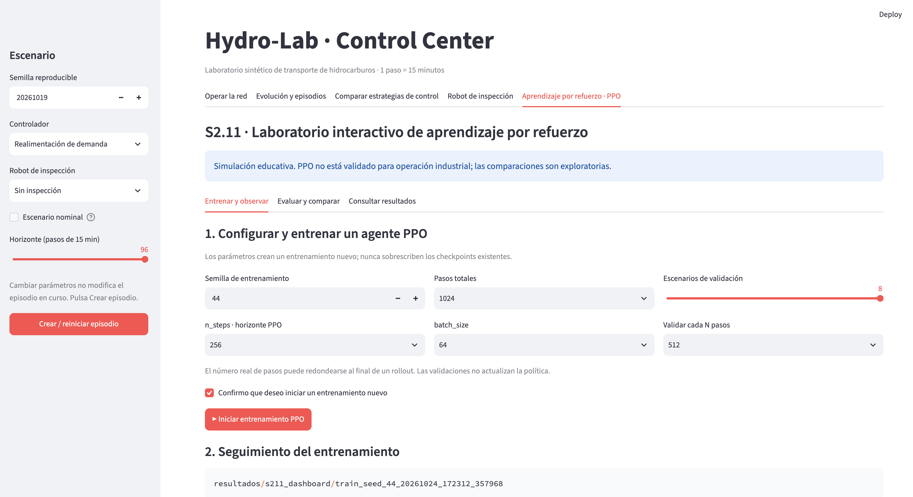
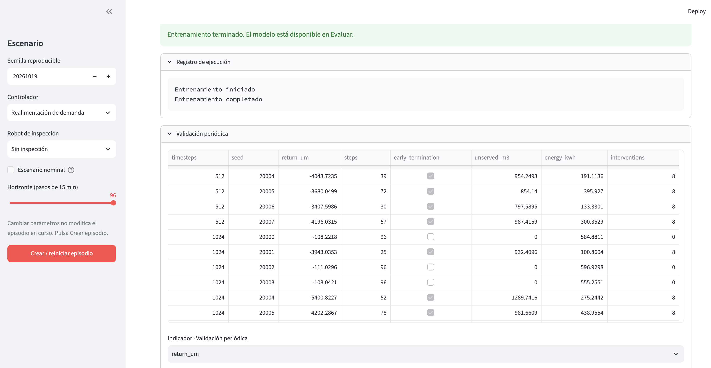
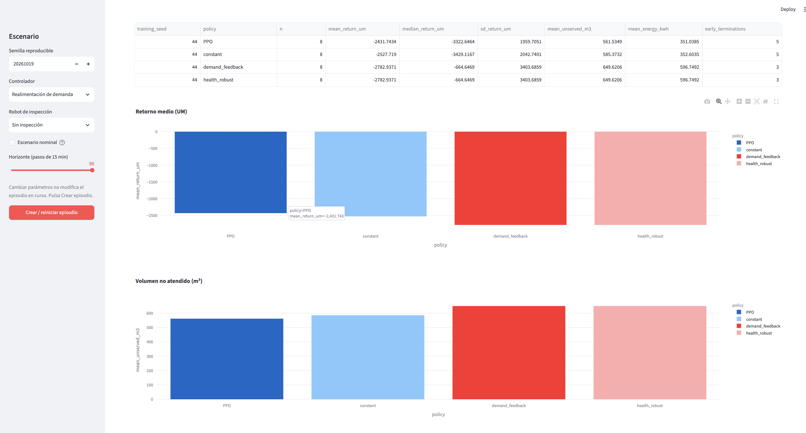
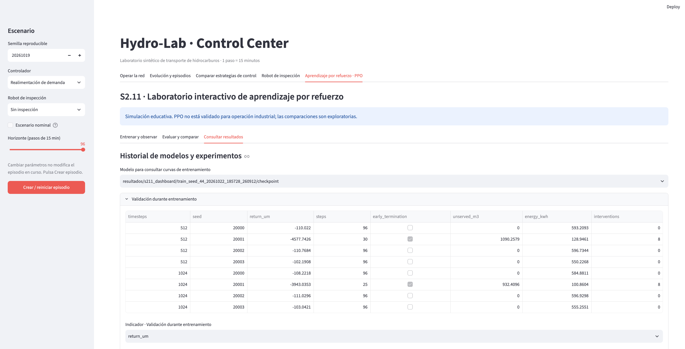
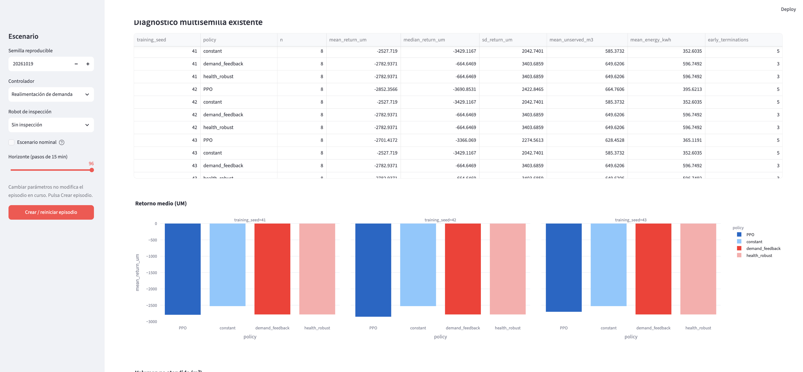

# ENTRA. DECIDE. OBSERVA.

## Manual de uso de Hydro-Lab Control Center

**Edición S2.11 · Generación documental G3.1 · 23 de octubre de 2026**

**Destinatarios:** estudiantes con distintos niveles de experiencia en procesos industriales, simulación e inteligencia artificial.

**Alcance:** operación hidráulica, inspección robótica, comparaciones, entrenamiento interactivo PPO, evaluación y consulta de resultados. Documento de uso y referencia funcional.

> **Tu misión:** operar una red sintética de transporte. Tres bombas, una demanda cambiante, recursos limitados y decisiones con consecuencias. Puedes asumir el mando o dejar que un controlador automático elija las órdenes. No tienes que acertar a la primera: aquí se aprende experimentando.


*Figura M-00. Pantalla de bienvenida de Hydro-Lab: el punto de entrada al laboratorio.*

Hydro-Lab es un entorno de aprendizaje, **no un sistema industrial real ni un simulador calibrado para una instalación específica**. Puedes probar decisiones, observar resultados, equivocarte y reiniciar. La idea es descubrir cómo se relacionan la operación física, el consumo de energía, el cumplimiento de la demanda y el costo de obtener información.

### Cómo utilizar este manual

No necesitas programar para comenzar. Las instrucciones te indicarán qué seleccionar, dónde hacer clic y qué observar. Cuando aparezcan términos técnicos, los explicaremos antes de utilizarlos. Los estudiantes con mayor experiencia encontrarán después comparaciones, trazas y experimentos reproducibles.

### Un laboratorio abierto: úsalo, compréndelo, modifícalo

Hydro-Lab es una plataforma educativa de código abierto, diseñada para aprender a tomar decisiones secuenciales en un sistema físico sintético. No es una caja negra ni un producto cerrado. Quien quiera ir más allá de la interfaz puede leer el código, cambiar controladores, diseñar recompensas, añadir escenarios, comparar métodos y desarrollar soluciones propias. **Hackear Hydro-Lab, en este contexto, significa comprenderlo y transformarlo creativamente**, conservando la disciplina de pruebas reproducibles.

La licencia propuesta para el código original es **MIT**, permisiva incluso para desarrollos comerciales, sujeta a la conservación de los avisos correspondientes. La licencia se hará efectiva cuando el titular de derechos publique el archivo `LICENSE` en el repositorio y se comprueben las condiciones de redistribución de los componentes de terceros. Los resultados del laboratorio son sintéticos: ninguna modificación autoriza su uso directo en infraestructura industrial sin validación y controles de seguridad independientes.

## 1. Antes de empezar: conoce la red y aprende a decidir

### 1.1 ¿Qué estamos simulando?

Imagina que trabajas en un centro de operaciones. Una red debe transportar hidrocarburos y atender una demanda que cambia a lo largo del día. Para mover el producto dispones de bombas; para decidir cómo utilizarlas debes considerar las condiciones de la red, la energía consumida y el estado de los equipos.


*Figura 1. Arquitectura general de Hydro-Lab G2.4. Úsala como mapa conceptual del sistema; más adelante reconocerás sus componentes en la aplicación.*

El modelo hidráulico contiene **cinco nodos** y **tres bombas**, identificadas como **P0**, **PN** y **PS**. Las bombas impulsan el fluido; las tuberías y los nodos forman la red por la que circula. El simulador calcula cómo responde ese sistema cuando se aplican determinadas órdenes de operación.

Por ahora recuerda solo tres cosas: existe una **red física**, hay una **demanda que debemos atender** y debemos elegir **cómo operar las bombas**. No hace falta conocer todavía las ecuaciones hidráulicas.

### 1.2 ¿Qué significa tomar una decisión?

Tomar una decisión en Hydro-Lab significa elegir las **consignas de operación** de las bombas para el siguiente intervalo de tiempo. Una consigna es una orden que indica cómo debe trabajar un equipo; no es una medición del caudal producido.

Las consignas de P0, PN y PS son números normalizados entre **0,60 y 1,00**. En este laboratorio, `0,60` es el extremo inferior permitido y `1,00` el superior. **No equivalen directamente a metros cúbicos por segundo ni a porcentajes de demanda atendida.** El simulador interpreta esas órdenes y calcula su efecto sobre la red.

Por ejemplo, podrías elegir `P0 = 0,80`, `PN = 0,70` y `PS = 0,90`. Eso no garantiza un resultado bueno: operar más intensamente puede ayudar a satisfacer la demanda, pero también consumir más energía. La cuestión interesante es **qué combinación conviene en cada situación**.

### 1.3 ¿Qué es exactamente un controlador?

Un **controlador** es quien —o aquello que— decide qué órdenes enviar a un sistema para alcanzar un objetivo. Su tarea no consiste en transportar el producto: consiste en **elegir las consignas que recibirán las bombas**.

Piensa en conducir un automóvil. Quieres mantener una velocidad determinada. Observas el velocímetro, comparas la velocidad real con la deseada y decides si debes acelerar o reducir la presión sobre el pedal. Ese proceso de **observar, decidir y actuar** es la idea básica del control.

En Hydro-Lab, el ciclo es semejante:

1. Se dispone de información sobre la red y su operación.
2. El controlador selecciona las consignas de P0, PN y PS.
3. El simulador aplica las consignas y calcula la respuesta física.
4. Se observan los resultados y comienza una nueva decisión.

Un controlador automático no tiene por qué ser una inteligencia artificial que aprende: puede ser una regla programada por un ingeniero. **Automático** significa aquí que el programa elige las consignas durante la simulación; **manual** significa que las eliges tú.

### 1.4 ¿Puedo mover las bombas personalmente?

**Sí. Y lo hemos comprobado en la aplicación.** Para tomar el mando, utiliza esta secuencia cuando llegues a la interfaz:

1. En la barra lateral izquierda, busca **Controlador** y selecciona **Manual**.
2. Pulsa **Crear / reiniciar episodio**. Sin este paso, el episodio anterior conserva su configuración.
3. Abre la pestaña **Operar la red**.
4. Localiza los deslizadores **P0**, **PN** y **PS**. Ahora podrás moverlos entre `0,60` y `1,00`, siempre que el episodio esté activo.
5. Pulsa **▶ Un paso** para aplicar esas consignas durante el siguiente intervalo y observar qué ocurre.

Si los deslizadores aparecen grises o inactivos, **no significa necesariamente que haya un error**: verifica que hayas elegido *Manual* y reiniciado el episodio. Con un controlador automático, los deslizadores se muestran bloqueados porque las consignas las selecciona el algoritmo.

### 1.5 ¿Qué controladores automáticos encontrarás?

No necesitas aprender sus fórmulas ahora. Basta con entender por qué pueden comportarse de manera diferente.

| Opción del controlador | Idea inicial |
|---|---|
| **Manual** | Tú eliges las consignas de las tres bombas. |
| **Realimentación de demanda** | El programa adapta las consignas considerando la demanda y la información operativa disponible. |
| **Consciente de la salud** | También considera estimaciones del estado de salud de las bombas. |
| **Robusto ante la incertidumbre** | Procura evitar decisiones demasiado sensibles a estimaciones inciertas de la salud de los equipos. |

Más adelante podrás comparar sus resultados. **Que una estrategia sea más elaborada no significa que siempre gane.** Ese es precisamente uno de los descubrimientos que ofrece el laboratorio.

### 1.6 ¿Qué ocurre cuando avanzo el tiempo?

Cada **paso** equivale a **15 minutos simulados**. Un episodio de **96 pasos** representa un horizonte máximo de 24 horas, aunque una contingencia puede terminarlo antes.

En cada paso, el simulador aplica las consignas, actualiza el estado de la red y registra indicadores. Entre ellos encontrarás:

- **Demanda no atendida:** producto requerido que no logró entregarse.
- **Energía:** consumo asociado a la operación.
- **Recompensa:** valoración numérica sintética de los resultados, que permite comparar estrategias dentro del laboratorio. No equivale a la utilidad financiera real de una empresa.

No juzgues una decisión por una sola cifra. Una mayor entrega puede exigir más energía; una menor operación puede ahorrar energía y dejar demanda sin atender. **Controlar consiste en comprender esos compromisos.**

### 1.7 ¿Y el robot de inspección?

Además de operar las bombas, Hydro-Lab permite utilizar un robot que se desplaza e inspecciona equipos para obtener información sobre su estado. **Inspeccionar no significa reparar.** Mover el robot y realizar inspecciones tiene costos y consume batería. Más adelante aprenderás a usarlo; por ahora basta con saber que permite explorar otra pregunta: **¿cuándo vale la pena pagar por conocer mejor el sistema?**

### 1.8 Tu primer encuentro con la aplicación

Vamos a comenzar sin complicaciones: el controlador automático tomará las primeras decisiones y tú observarás sus consecuencias. Cuando comprendas la pantalla, volverás para asumir el mando manual.

1. Abre la aplicación siguiendo las instrucciones de la sección 2.
2. En la barra lateral, selecciona **Controlador = Realimentación de demanda** y **Robot de inspección = Sin inspección**.
3. Pulsa **Crear / reiniciar episodio**.
4. Entra en **Operar la red** y pulsa **▶ Un paso**.
5. Busca el contador de pasos, la recompensa acumulada y las métricas del último paso. Has simulado **15 minutos de operación**.


*Figura M-01. Primer paso de operación: un controlador eligió las consignas, la red respondió y el simulador registró las consecuencias.*

**¿Qué acabas de hacer?** No has programado un controlador ni elegido manualmente las consignas: has seleccionado una estrategia automática, ejecutado una transición del sistema y observado el resultado. Ya estás utilizando el laboratorio.

**Tu primera pregunta:** ¿crees que el resultado cambiaría si tú eligieras las consignas? Pronto podrás comprobarlo.

---

## 2. Preparar el entorno y abrir la aplicación

Hydro-Lab se utiliza desde un navegador, pero su simulación se ejecuta localmente. Puedes obtener la versión del curso desde GitHub descargando un ZIP o clonando el repositorio. El proyecto utiliza **Python 3.12**. La interfaz S2.11 se ha probado en macOS; en otros sistemas es necesario verificar dependencias y ejecución local antes del curso. Para evitar conflictos con otros proyectos, instala sus dependencias en un entorno virtual exclusivo.


### 2.1. Obtener Hydro-Lab desde GitHub

El código fuente y la documentación de Hydro-Lab se encuentran en el repositorio oficial de Aprendizaje Profundo:

**[Repositorio oficial de Hydro-Lab](https://github.com/AprendizajeProfundo/hydro-lab)**

Para obtener el laboratorio existen dos alternativas.

**Opción A. Descargar el proyecto como ZIP**

1. Abre el repositorio en GitHub.
2. Pulsa el botón verde **Code**.
3. Selecciona **Download ZIP**.
4. Descomprime el archivo en una carpeta de tu computador.

**Opción B. Clonar el repositorio (usuarios avanzados)**

Si tienes Git instalado, abre una terminal y ejecuta:

```bash
git clone https://github.com/AprendizajeProfundo/hydro-lab.git
cd hydro-lab
```

Ambas alternativas proporcionan los archivos necesarios para instalar y ejecutar el laboratorio. A continuación, se explica cómo preparar el entorno Python y sus dependencias.


### 2.2 Crear un entorno virtual e instalar Hydro-Lab

Elige **una sola** de estas alternativas. Ambas aíslan las dependencias del laboratorio.

**Alternativa A — Conda (Windows, macOS o Linux).** Necesitas Conda o Miniconda instalado:

```bash
conda create -n hydro-lab python=3.12 -y
conda activate hydro-lab
python -m pip install -e ".[dev,ui]"
```

Cuando vuelvas a abrir Hydro-Lab otro día, bastará con activar el entorno existente mediante `conda activate hydro-lab`; **no** es necesario crearlo de nuevo.

**Alternativa B — Python `venv` + `pip`.** No necesitas Conda. Debes tener Python 3.12 instalado.

En **Windows (PowerShell)**:

```powershell
py -3.12 -m venv .venv
.\.venv\Scripts\python.exe -m pip install -e ".[dev,ui]"
```

En **macOS o Linux**:

```bash
python3.12 -m venv .venv
source .venv/bin/activate
python -m pip install -e ".[dev,ui]"
```

En Windows utilizamos directamente el Python del entorno para no exigir cambios en la política de ejecución de PowerShell. En macOS y Linux, `source` activa el entorno. Si Python 3.12 no se reconoce, instálalo antes de continuar.

### 2.3 Comprobar la instalación

Desde la carpeta principal del proyecto, ejecuta la suite de pruebas. Si elegiste Conda o activaste `venv` en macOS/Linux:

```bash
python -m pytest
```

Si elegiste `venv` en Windows PowerShell:

```powershell
.\.venv\Scripts\python.exe -m pytest
```

Una ejecución satisfactoria termina sin pruebas fallidas. Si aparece un error, conserva el mensaje para diagnosticarlo; no continúes como si la instalación estuviera verificada.

### 2.4 Abrir Hydro-Lab

En el entorno que acabas de preparar, inicia la aplicación. Con Conda o con `venv` activado:

```bash
python -m streamlit run dashboard/app.py
```

Con `venv` en Windows PowerShell:

```powershell
.\.venv\Scripts\python.exe -m streamlit run dashboard/app.py
```

Streamlit abrirá normalmente el navegador. Si no lo hace, copia la dirección **Local URL** que muestra la terminal; suele ser `http://localhost:8501`, aunque el puerto puede variar. **Mantén abierta la terminal** mientras utilices la aplicación.


*Figura M-02. La terminal ejecuta Hydro-Lab localmente y el navegador presenta su interfaz de trabajo.*

### 2.5 Comprobar la pantalla inicial y cerrar

Comprueba que aparece **Hydro-Lab · Control Center**, la aplicación Hydro-Lab con la quinta pestaña **Aprendizaje por refuerzo · PPO** y la indicación **1 paso = 15 minutos**. Verás también la barra lateral de configuración y la pestaña **Operar la red**.

Cuando termines, vuelve a la terminal y pulsa **Ctrl+C**. Cerrar únicamente la pestaña del navegador no necesariamente detiene Streamlit.

## 3. Orientarte: el mapa de la aplicación

Hydro-Lab tiene **una barra lateral** y **cinco pestañas**. La barra lateral fija las condiciones del episodio; las pestañas sirven para operar, analizar, comparar y observar al robot.

| Zona | Rótulo exacto | Para qué sirve |
|---|---|---|
| Barra lateral | Escenario | Configurar semilla, controlador, robot, modo nominal y horizonte |
| Pestaña 1 | Operar la red | Avanzar la simulación y, en modo manual, ajustar bombas y robot |
| Pestaña 2 | Evolución y episodios | Inspeccionar gráficos, métricas, trazas y descargar resultados |
| Pestaña 3 | Comparar estrategias de control | Ejecutar tres experimentos pareados y examinar sus inferencias estadísticas |
| Pestaña 4 | Robot de inspección | Revisar ubicación, batería, eventos, estimaciones e incertidumbre |
| Pestaña 5 | Aprendizaje por refuerzo · PPO | Configurar y ejecutar entrenamiento, evaluar checkpoints, comparar políticas y consultar el historial |

Si la barra lateral no aparece, expándela desde el control de Streamlit en el borde izquierdo; el icono puede variar con la versión.


*Figura M-03. mapa general de la aplicación.*

## 4. La barra lateral: cinco decisiones antes de comenzar

**Semilla reproducible.** Es un número que permite repetir una secuencia pseudoaleatoria. Para comparaciones justas, conserva la misma semilla y modifica una sola decisión a la vez. La semilla predeterminada es **20261019**.

**Controlador.** Hay cinco opciones: **Realimentación de demanda**, **Control sensible a salud**, **Control robusto a ruido**, **Velocidad constante** y **Manual**. El controlador determina cómo se eligen las consignas hidráulicas.

**Robot de inspección.** Hay cuatro opciones: **Sin inspección**, **Control manual**, **Priorizar incertidumbre** e **Inspección costo-consciente**. Este selector es independiente del controlador hidráulico.

**Escenario nominal.** Al activarlo se utilizan exógenas nominales; **no elimina el modelo de fallas**. No equivale a «sin riesgos».

**Horizonte (pasos de 15 min).** Puede ir de **1 a 96**. Un día completo tiene 96 pasos. El horizonte limita la duración máxima, pero una contingencia puede terminar antes el episodio.

**Regla fundamental:** cambiar cualquiera de estos selectores **no altera el episodio que ya está corriendo**. Para aplicar la configuración nueva, pulsa **Crear / reiniciar episodio**. Eso reemplaza el episodio activo; descarga los datos antes si deseas conservarlos.


*Figura M-04. barra lateral de la aplicación. El episodio comienza con una decisión de diseño experimental.**

### Antes de cada recorrido: ficha de configuración

Anota: **semilla**, **controlador**, **política del robot**, **escenario nominal sí/no**, **horizonte**. Si cambias alguno, crea un episodio nuevo. Si vas a comparar dos recorridos, guarda ambas fichas.

## 5. Operar la red: bombas, acciones y tiempo

En **Operar la red** encontrarás un esquema con **cinco nodos** y tres bombas identificadas como **P0** (principal), **PN** (norte) y **PS** (sur). Los nodos `N0`–`N4` pertenecen a la red hidráulica; las estaciones `BASE`, `P0`, `PN` y `PS` del robot son **otro grafo**, de acceso logístico. No confundas ambos mapas.

Las tres consignas de velocidad van de **0,60 a 1,00**. Solo puedes mover sus deslizadores si elegiste el controlador **Manual** y el episodio no ha terminado. En los demás controladores la política selecciona las consignas y los deslizadores aparecen deshabilitados.

| Botón | Acción real |
|---|---|
| **▶ Un paso** | Avanza hasta un paso adicional de 15 minutos |
| **▶ 1 hora** | Avanza hasta cuatro pasos adicionales |
| **▶ Hasta el final** | Intenta ejecutar todos los pasos restantes del horizonte |

**Atención:** estos botones **añaden** pasos; no llevan el contador a 1, 4 o 96 desde cero. Si el episodio termina por contingencia, pueden ejecutarse menos pasos.

En la parte inferior verás métricas del **último paso**: energía en kWh, demanda no atendida en m³, estado hidráulico y seguridad. En cambio, **Recompensa acumulada** agrega el resultado de la trayectoria ejecutada.


*FIGURA M-05 — Controles de operación. Las decisiones hidráulicas y robóticas se ejecutan al avanzar el reloj.*

## 6. Recorrido guiado A: operar un día completo

**Objetivo:** completar un episodio sin intervención manual, identificar las principales métricas y guardar los resultados.

**Configuración:** semilla `20261019`; controlador **Realimentación de demanda**; robot **Sin inspección**; escenario nominal **desactivado**; horizonte **96**. Pulsa **Crear / reiniciar episodio**.

1. En **Operar la red**, pulsa **▶ Un paso**. Comprueba **1 / 96**.
2. Pulsa **▶ 1 hora**. Comprueba el nuevo contador: normalmente **5 / 96**.
3. Pulsa **▶ Hasta el final**. Espera a que termine la ejecución.
4. Observa el aviso **Horizonte completado (truncado)** o **Episodio terminado por contingencia**. Ambos son finales válidos del episodio, pero **no significan lo mismo**.
5. Abre **Evolución y episodios**. Examina inventarios, demanda, recompensa, energía y demanda no atendida.
6. Pulsa **Descargar episodio JSON**. Guarda el archivo para poder recuperar la trayectoria.

**Comprueba:** puedes explicar en una frase si el episodio llegó al horizonte y qué ocurrió con la demanda no atendida.

**Prueba tú:** repite con **Escenario nominal** activado, usando la misma semilla. ¿Cambian las curvas? ¿Por qué una comparación de un único episodio no prueba que una estrategia sea superior?


*FIGURA M-06 — Episodio completo. Un episodio puede terminar por horizonte o por contingencia; distingue ambos casos.*

**Una observación didáctica:**

*Escenario nominal*. Configuración de referencia en la que el simulador utiliza condiciones externas nominales, sin las perturbaciones exógenas aleatorias habituales. Permite analizar y comparar el comportamiento de los controladores bajo condiciones más controladas. No desactiva el deterioro ni las posibles fallas de los equipos y tampoco garantiza que el episodio termine satisfactoriamente.

 Escenario nominal no es sinónimo de escenario fácil. Es un escenario de referencia, útil para separar el comportamiento de un controlador de parte de la variabilidad ambiental.

## 7. Evolución y episodios: leer sin confundirse

Esta pestaña aparece vacía al inicio y pide ejecutar al menos un paso. Después muestra un selector **Inspeccionar paso**, gráficos temporales y un resumen del episodio.

**Inventarios observados (m³).** Siguen los volúmenes observados en dos nodos de referencia. Son observaciones del sistema, no un dibujo de todo el estado físico.

**Demanda observada (m³/s).** Representa una tasa; **no** es el mismo tipo de magnitud que la demanda no atendida expresada en m³ por paso.

**Recompensa acumulada (UM).** Integra la evaluación de las decisiones hasta el instante considerado. Una cifra menos negativa suele indicar un resultado mejor **bajo la función de recompensa del simulador**, no necesariamente bajo todos los criterios de ingeniería.

**Energía (kWh) y déficit (m³) por paso.** El gráfico comparte un eje visual para magnitudes con **unidades y escalas distintas**. No compares alturas como si fueran unidades equivalentes.

El resumen inferior muestra **Energía total**, **Demanda no atendida total**, **Intervenciones** y **Error máx. masa**. El error de balance es una comprobación numérica; no es una medida de calidad de la política.


*FIGURA M-07 — Evolución temporal. La trayectoria importa: un resultado final no cuenta toda la historia. Medir, registrar y conservar el experimento es parte del aprendizaje*


### La tabla de trazas

Abre **Tabla de trazas (datos de evaluación)**. Cada fila corresponde a un paso. Puedes inspeccionar, entre otros, la hora, la acción ejecutada, energía, demanda no atendida y recompensa. **No confundas la acción solicitada con la ejecutada:** la lógica de seguridad puede intervenir. Algunas columnas son diagnósticos de evaluación y no información accesible a las políticas.


*FIGURA M-09 — Una decisión defendible deja un registro verificable.*


## 8. Recorrido guiado B: tomar el mando manual

**Objetivo:** comprobar que una consigna modifica la evolución, sin atribuir automáticamente causalidad a un solo cambio.

1. En la barra lateral elige **Controlador = Manual** y **Robot = Sin inspección**.
2. Conserva la semilla y el horizonte. Pulsa **Crear / reiniciar episodio**.
3. En **Operar la red**, fija P0, PN y PS en **0,80**. Pulsa **▶ Un paso**.
4. Anota **Energía**, **Demanda no atendida** y **Recompensa acumulada**.
5. Cambia **solo PN** a **0,90**. Pulsa **▶ Un paso**.
6. En **Evolución y episodios**, usa **Inspeccionar paso** para comparar los pasos 1 y 2; abre la tabla de trazas.

**¿Qué significa?** Una consigna mayor no implica necesariamente una recompensa mejor. Puede elevar el consumo energético o encontrar restricciones físicas. Además, la demanda y el estado también evolucionan: no interpretes la diferencia entre dos instantes como un experimento controlado perfecto.

**Prueba tú (comparación más justa):** reinicia con la misma semilla y repite dos episodios manuales idénticos salvo por una consigna inicial. Conserva ambas trazas.


*FIGURA M-10— Control manual: la persona propone las consignas; el sistema impone la física y la seguridad.*

## 9. Recorrido guiado C: comparar estrategias de control

**Objetivo:** comprender cómo distintas estrategias toman decisiones sobre una misma red hidráulica, evaluar sus resultados mediante experimentos reproducibles y reconocer que una estrategia más sofisticada no necesariamente produce mejores resultados en todas las condiciones.

### 9.1. ¿Qué vamos a comparar y por qué?

En una red de transporte de hidrocarburos, operar las bombas implica tomar decisiones que afectan simultáneamente el consumo energético, la satisfacción de la demanda, la seguridad y los costos de operación.

No existe una única manera de tomar esas decisiones. Un controlador puede mantener constantes las consignas de las bombas, reaccionar ante cambios de demanda o utilizar información adicional sobre el estado de los equipos. También es posible incorporar un robot que inspeccione las bombas para reducir la incertidumbre sobre su condición.

En esta actividad estudiaremos tres preguntas:

1. **¿Es mejor reaccionar a la demanda que mantener las bombas a velocidad constante?**
2. **¿Qué valor aporta inspeccionar las bombas y obtener información adicional sobre su estado?**
3. **¿Cómo cambia el desempeño de un controlador robusto cuando se combina con inspección costo-consciente y se enfrenta a diferentes condiciones operativas?**

Para responderlas utilizaremos la pestaña **Comparar estrategias de control**, que contiene tres experimentos independientes.

Estos experimentos utilizan políticas de control previamente definidas. **No entrenan una política de aprendizaje por refuerzo.** Su propósito es comprender el problema de control y establecer referencias que posteriormente permitan interpretar el comportamiento de una política entrenada mediante PPO.

### 9.2. Conceptos necesarios antes de comenzar

**Controlador o política de control.** Es el procedimiento que determina las acciones que deben ejecutarse a partir de la información disponible. En Hydro-Lab, las acciones hidráulicas corresponden a las consignas de velocidad de las bombas.

**Control fijo.** Mantiene consignas predeterminadas, sin modificarlas continuamente en respuesta a la demanda observada.

**Control por realimentación.** Utiliza observaciones del sistema para ajustar las acciones. En nuestro laboratorio, el controlador de realimentación responde a la demanda observada.

**Control sensible a salud.** Incorpora estimaciones del estado de las bombas en sus decisiones. Es importante distinguir entre el estado real de una bomba y la estimación disponible para el controlador: esta última puede ser incierta.

**Control robusto.** Es una estrategia diseñada para tener en cuenta perturbaciones e incertidumbre. La palabra *robusto* describe su enfoque de diseño; no significa que garantice mejores resultados ni que elimine las contingencias.

**Inspección robótica.** El robot puede desplazarse e inspeccionar equipos para obtener información. Una inspección produce una medición, pero no repara la bomba. Además, desplazarse e inspeccionar consume recursos.

**Recompensa.** Es una medida sintética, expresada en unidades monetarias del modelo (UM), que resume los efectos de las decisiones y sus penalizaciones. Una recompensa mayor —o menos negativa— representa un mejor resultado según la función de recompensa definida en el laboratorio. No equivale necesariamente a una utilidad financiera real.

**Semilla de simulación.** Es un número que permite reproducir las condiciones aleatorias de un experimento. Si dos políticas se evalúan con la misma semilla y el mismo escenario, la comparación controla parte de la variabilidad introducida por la simulación.

### Demanda no atendida media — `mean_unserved`

Representa el **volumen promedio de hidrocarburo que no pudo entregarse para satisfacer la demanda solicitada** durante los episodios evaluados. Se expresa en metros cúbicos (m³).

Para cada episodio se acumula el volumen de demanda no atendida en sus distintos intervalos; posteriormente se calcula el promedio entre episodios.

**Interpretación:** cuanto menor sea este indicador, mejor habrá sido el cumplimiento de la demanda, siempre que las condiciones de comparación sean equivalentes. Un valor de cero indica que no hubo demanda insatisfecha en los episodios considerados.

### Intervenciones medias de seguridad — `mean_interventions`

Indica el **número promedio de intervenciones realizadas por el mecanismo de seguridad del simulador** durante los episodios evaluados.

Una intervención ocurre cuando el sistema debe corregir o limitar una acción propuesta por el controlador para respetar las restricciones operativas implementadas.

**Interpretación:** un valor elevado puede indicar que el controlador propone frecuentemente acciones incompatibles con las restricciones. Sin embargo, una intervención no equivale necesariamente a una falla ni a una terminación del episodio. El indicador permite evaluar hasta qué punto una política depende de las correcciones del sistema de seguridad.

### Tasa de terminación anticipada — `termination_rate`

Representa la **proporción de episodios que finalizaron por una contingencia antes de completar el horizonte de simulación previsto**.

Se calcula como:

$$
\text{termination\_rate}
=
\frac{\text{episodios terminados anticipadamente}}
{\text{total de episodios evaluados}}.
$$

**Interpretación:** un valor de 0 indica que ningún episodio terminó anticipadamente; un valor de 0,20 indica que el 20 % de los episodios finalizaron por contingencia. En general, una tasa menor es deseable, aunque debe interpretarse junto con los demás indicadores.

**Precaución:** cuando dos estrategias presentan tasas de terminación diferentes, sus promedios de energía, recompensa y demanda no atendida pueden corresponder a duraciones distintas. Por tanto, una estrategia que termina prematuramente no debe considerarse mejor únicamente porque acumuló menos consumo energético.

### ¿Por qué puede terminar prematuramente un episodio?

En Hydro-Lab, un episodio tiene un horizonte máximo de simulación, normalmente de **96 pasos de 15 minutos**, equivalentes a 24 horas. Sin embargo, no todos los episodios alcanzan ese horizonte.

El simulador incorpora restricciones operativas y mecanismos de seguridad. Cuando la evolución del sistema conduce a una condición que impide continuar la operación de manera admisible, el episodio puede finalizar anticipadamente.

Estas situaciones pueden estar relacionadas con el comportamiento hidráulico, la disponibilidad de los equipos o la imposibilidad de mantener una operación factible dentro de las restricciones del modelo.

Es importante distinguir dos mecanismos:

- **Intervención de seguridad:** el simulador corrige o limita una acción propuesta por el controlador. El episodio puede continuar.
- **Terminación anticipada:** se alcanza una condición de contingencia que obliga a finalizar el episodio antes del horizonte previsto.

Por tanto, una intervención no implica necesariamente una terminación.

**¿Qué significa para la evaluación de los controladores?**

Una política puede obtener una recompensa favorable durante los primeros intervalos y, sin embargo, provocar condiciones que impidan completar la operación. Por eso, evaluar únicamente la recompensa acumulada puede resultar engañoso.

Además, un episodio que termina antes consume energía y acumula demanda no atendida durante menos intervalos. Sus resultados totales no son directamente comparables, sin precauciones, con los de otro episodio que completó las 24 horas.

La **tasa de terminación anticipada (`termination_rate`)** permite cuantificar con qué frecuencia ocurre esta situación en un conjunto de simulaciones.

**Lección fundamental:** un buen controlador no solo debe tomar decisiones eficientes; también debe procurar que el sistema permanezca dentro de condiciones operativas admisibles a lo largo del horizonte de evaluación.

**Experimento pareado.** Consiste en evaluar diferentes estrategias bajo condiciones comunes y calcular sus diferencias. Es más informativo que comparar dos ejecuciones realizadas con escenarios aleatorios independientes.

**Importante:** utilizar las mismas semillas no garantiza que dos estrategias recorran exactamente las mismas trayectorias. Sus decisiones pueden modificar la evolución del sistema. Lo que buscamos es establecer condiciones de comparación reproducibles.

**Nota pedagógica**

**¿Qué significa que un controlador sea robusto?** Un controlador convencional toma decisiones buscando un buen desempeño bajo determinadas condiciones de funcionamiento. Sin embargo, en una instalación real esas condiciones pueden cambiar: una bomba puede perder eficiencia, las mediciones pueden ser imprecisas y la demanda puede variar inesperadamente. Un **controlador robusto** está diseñado para que sus decisiones sigan siendo razonablemente eficaces incluso cuando el sistema se aparta de las condiciones previstas. Su propósito no es necesariamente obtener el mejor resultado cuando todo funciona normalmente, sino **reducir la vulnerabilidad del sistema frente a perturbaciones e incertidumbre**. Imaginemos dos controladores: uno consigue un consumo energético excelente cuando todas las bombas están en buen estado, pero su desempeño se deteriora considerablemente cuando una pierde capacidad; el otro consume algo más de energía en condiciones normales, pero mantiene un suministro más estable ante esa degradación. El segundo presenta un comportamiento más robusto frente a esa perturbación. Esto no significa que siempre sea superior: la robustez depende de las perturbaciones consideradas y debe comprobarse experimentalmente. Precisamente por eso, en Hydro-Lab evaluamos las estrategias bajo operación de referencia, degradación y desgaste acelerado.

*Un controlador puede ser óptimo para una condición particular y, sin embargo, ser poco robusto cuando las condiciones cambian.*

**¿Qué es un experimento pareado y por qué lo utilizamos?** Imaginemos que queremos comparar dos controladores de una red hidráulica. Si ejecutamos el primero cuando las bombas están en buen estado y la demanda es moderada, pero evaluamos el segundo cuando una bomba está degradada y la demanda es elevada, no podremos determinar si las diferencias observadas se deben al controlador o a las condiciones de operación. Un **experimento pareado** busca evitar esa confusión: evaluamos ambos controladores bajo un mismo escenario inicial y con una misma semilla de simulación, de modo que la comparación se realice en condiciones reproducibles. Para cada semilla calculamos la diferencia entre las recompensas obtenidas por las dos estrategias y, finalmente, promediamos esas diferencias. Así, cada pareja de ejecuciones constituye una comparación directa. Este procedimiento permite controlar parte de la variabilidad del experimento y puede mejorar la precisión de la comparación. Sin embargo, **utilizar las mismas semillas no garantiza trayectorias idénticas ni elimina toda la incertidumbre**: los controladores toman decisiones diferentes y, por tanto, pueden producir evoluciones distintas del sistema. Además, una diferencia media favorable en unas pocas semillas no demuestra que una estrategia sea siempre superior. Para establecer conclusiones más generales necesitaríamos un número suficiente de réplicas y un análisis estadístico de las diferencias pareadas.


### 9.3. Experimento 1: control fijo frente a realimentación de demanda

**Pregunta:** ¿qué cambia cuando un controlador puede reaccionar a la demanda observada?

Este primer experimento compara dos estrategias:

| Estrategia | ¿Cómo toma decisiones? | ¿Qué permite estudiar? |
|---|---|---|
| Velocidad constante | Mantiene consignas de velocidad predeterminadas | El comportamiento de una referencia sencilla |
| Realimentación de demanda | Ajusta las consignas utilizando información de demanda | El efecto de reaccionar ante cambios del sistema |

La velocidad constante sirve como referencia. Su sencillez no debe interpretarse como una desventaja automática: una política simple puede funcionar razonablemente bien en determinadas condiciones.

La realimentación incorpora capacidad de respuesta, pero sus ajustes también pueden producir efectos no deseados. Por ello, la comparación debe resolverse mediante resultados observados, no mediante suposiciones sobre cuál estrategia debería ganar.

**Procedimiento**

1. Abre la pestaña **Comparar estrategias de control**.
2. Localiza la sección **Control fijo frente a realimentación de demanda**.
3. Selecciona **Número de semillas pareadas = 5**.
4. Conserva **Primera semilla = 1000**.
5. Pulsa **Ejecutar comparación**.
6. Examina la tabla de resultados y el indicador **Diferencia media pareada de recompensa**.

El laboratorio evalúa ambas estrategias con las semillas 1000, 1001, 1002, 1003 y 1004.

La diferencia pareada para una semilla puede expresarse como:

$$
D_i=R_i(\text{realimentación})-R_i(\text{constante})
$$

donde $R_i$ representa la recompensa obtenida bajo la semilla $i$.

El indicador mostrado en la interfaz es la media de estas diferencias:

$$
\overline{D}=\frac{1}{n}\sum_{i=1}^{n}D_i
$$

**Interpretación**

- Si la diferencia media es positiva, la realimentación obtuvo una recompensa mayor en el conjunto de semillas evaluado.
- Si es negativa, la velocidad constante obtuvo una recompensa mayor.
- Si está próxima a cero, las recompensas medias fueron similares en esa comparación.

No debemos confundir esta interpretación con una demostración de superioridad general. Cinco semillas son suficientes para una actividad exploratoria, pero no para establecer conclusiones estadísticas sólidas sobre todas las condiciones posibles.

**Preguntas para el estudiante**

¿Por qué la realimentación podría reducir el déficit de suministro? ¿Podría también aumentar el consumo energético? ¿Qué información adicional necesitaríamos para determinar si una diferencia de recompensa es importante desde el punto de vista operativo?


*FIGURA M-11— Comparación pareada de controladores. La comparación pareada mantiene condiciones aleatorias comunes y permite estudiar el efecto de cambiar la estrategia de control.*
### 9.4. Experimento 2: el valor de la inspección robótica

**Pregunta:** ¿obtener información adicional sobre las bombas mejora las decisiones lo suficiente para compensar el costo de inspeccionarlas?

En el primer experimento comparamos dos maneras de controlar las bombas. Ahora incorporaremos un segundo sistema de decisiones: el robot de inspección.

El robot no transporta hidrocarburos ni modifica directamente las consignas hidráulicas. Su función consiste en desplazarse, inspeccionar y producir observaciones sobre el estado de las bombas.

Estas observaciones pueden mejorar las estimaciones disponibles para un controlador sensible a salud. Sin embargo, el beneficio no está garantizado: una inspección puede llegar demasiado tarde, aportar poca información relevante o costar más de lo que permite ahorrar.

El experimento evalúa cuatro combinaciones:

| Controlador hidráulico | Robot | Propósito |
|---|---|---|
| Realimentación de demanda | Apagado | Referencia sin inspección |
| Realimentación de demanda | Autónomo | Examinar el efecto de inspeccionar con un controlador que no utiliza explícitamente estimaciones de salud |
| Control sensible a salud | Apagado | Examinar el comportamiento del control sensible a salud sin nuevas inspecciones |
| Control sensible a salud | Autónomo | Estudiar el efecto conjunto del control sensible a salud y la observación activa |

En esta comparación, el robot autónomo utiliza una estrategia orientada a priorizar la incertidumbre. No debe confundirse con la política de inspección costo-consciente del tercer experimento.

**Procedimiento**

1. Dentro de **Comparar estrategias de control**, localiza **Valor de la inspección robótica**.
2. Selecciona **Semillas para inspección robótica = 5**.
3. Conserva **Primera semilla de inspección = 2000**.
4. Pulsa **Ejecutar comparación de inspección**.
5. Examina la tabla con los resultados de las cuatro combinaciones.
6. Observa el indicador **Valor neto pareado de inspección (política sensible a salud)**.

Este indicador compara, bajo semillas comunes, el resultado del control sensible a salud con robot autónomo frente al mismo controlador sin robot.

La recompensa neta considera los costos de las acciones robóticas. Por tanto, el interés no es simplemente contar inspecciones, sino determinar si sus posibles beneficios compensan los recursos utilizados.

**Interpretación**

Un valor neto positivo indica que, en las semillas evaluadas, incorporar la inspección produjo un resultado favorable según la recompensa del laboratorio.

Un valor negativo indica que la inspección no compensó su costo en esa comparación.

Esto no significa que inspeccionar sea siempre conveniente o inconveniente. El valor de la información depende del estado del sistema, de la incertidumbre, de las decisiones que pueden modificarse gracias a las observaciones y del costo de obtenerlas.

**Preguntas para el estudiante**

¿Por qué un robot puede reducir la incertidumbre sin mejorar la recompensa? ¿Qué sucede si inspecciona una bomba que funciona normalmente? ¿Qué diferencia existe entre obtener información y utilizarla eficazmente?


*FIGURA M-12 — Valor de la inspección robótica. Obtener información puede mejorar las decisiones, pero observar también consume recursos.*

### 9.5. Experimento 3: control robusto e inspección inteligente

**Pregunta:** ¿qué sucede cuando combinamos un controlador diseñado para afrontar incertidumbre con una política de inspección que considera sus costos, y evaluamos esa combinación bajo distintas condiciones operativas?

Este tercer experimento amplía el análisis anterior en dos sentidos.

Primero, incorpora un **controlador robusto**, que utiliza un enfoque diferente para tomar decisiones frente a perturbaciones e incertidumbre.

Segundo, incorpora una política de **inspección costo-consciente**, que puede decidir no inspeccionar cuando el beneficio esperado según su heurística no justifica los recursos necesarios.

Esta política robótica es una heurística de decisión, no una política entrenada mediante PPO ni un cálculo exacto del valor económico de la información.

#### Las cuatro estrategias evaluadas

| Estrategia | Control hidráulico | Política robótica |
|---|---|---|
| A | Sensible a salud | Sin robot |
| B | Sensible a salud | Inspección por incertidumbre |
| C | Robusto | Sin robot |
| D | Robusto | Inspección costo-consciente |

Las cuatro combinaciones se evalúan con semillas comunes en cada condición operativa.

Es importante comprender que **las estrategias B y D difieren tanto en el controlador hidráulico como en la política robótica**. Por ello, comparar directamente sus recompensas no permite atribuir cualquier diferencia exclusivamente al robot.

En cambio, comparar C frente a D permite estudiar el efecto de incorporar inspección costo-consciente manteniendo el mismo controlador hidráulico robusto.

#### Las tres condiciones operativas

El experimento se repite bajo tres regímenes sintéticos:

| Condición visible | Identificador interno | Qué permite estudiar |
|---|---|---|
| Operación de referencia | `baseline` | Desempeño bajo las condiciones de referencia del simulador |
| Operación degradada | `degraded` | Sensibilidad de las estrategias a condiciones de degradación |
| Desgaste acelerado | `accelerated_wear` | Comportamiento cuando el deterioro de los equipos se acelera |

Estos regímenes pertenecen al simulador sintético. No deben interpretarse como una representación calibrada de instalaciones reales de Ecopetrol.

#### Procedimiento

1. Localiza **Control robusto e inspección inteligente** en la pestaña **Comparar estrategias de control**.
2. Selecciona **Número de semillas para control robusto = 5** para una demostración con inferencia exploratoria (con 2 semillas, la prueba es especialmente frágil).
3. Pulsa **Ejecutar comparación de control robusto**.
4. La aplicación iniciará la ejecución del experimento.
5. Pulsa **Actualizar estado** para comprobar si ha terminado; este botón **no reinicia** el experimento. No pulses otra vez **Ejecutar comparación** mientras está en curso.
6. Cuando aparezca el mensaje **Comparación finalizada**, examina los resultados correspondientes a las tres condiciones operativas.
7. Si deseas conservar la evidencia, pulsa **Descargar resultados completos (ZIP)**.

Con cinco semillas se ejecutan **5 × 3 × 4 = 60 episodios**. Si necesitas una demostración más rápida, dos semillas producen 24 episodios, pero no permiten una inferencia sólida.

Para una comparación más amplia puedes repetir el experimento con cinco o diez semillas. El tiempo de ejecución aumentará proporcionalmente al número de episodios, aunque el tiempo exacto dependerá del equipo.

#### ¿Cómo leer las tablas?

Para cada condición operativa, la aplicación presenta las medias de los siguientes indicadores:

| Indicador | Significado |
|---|---|
| Recompensa media (UM) | Resultado medio según la función de recompensa |
| Energía media (kWh) | Energía consumida durante los episodios |
| Costo robótico medio (UM) | Costo de desplazamientos e inspecciones |
| Inspecciones medias | Número medio de inspecciones realizadas |
| Demanda no atendida media (m³) | Volumen medio de demanda que no pudo satisfacerse |

Estas magnitudes deben interpretarse conjuntamente.

Una estrategia puede obtener mayor recompensa y consumir más energía. Otra puede reducir el costo robótico, pero dejar una mayor demanda sin atender. El indicador de recompensa resume los criterios definidos en el modelo, pero no reemplaza la inspección de las variables físicas y operativas.

#### ¿Qué significa el efecto pareado?

Debajo de cada tabla aparece el indicador:

**Efecto pareado: control robusto con inspección frente a sin inspección.**

Este indicador compara exclusivamente las estrategias D y C:

$$
D_i=R_i(\text{robusto, inspección costo-consciente})
-R_i(\text{robusto, sin robot})
$$

La aplicación presenta la media de esas diferencias para las semillas evaluadas.

Si el efecto es positivo, la combinación con inspección obtuvo una recompensa mayor en esa condición operativa y ese conjunto de semillas.

Si es negativo, el control robusto sin robot obtuvo una recompensa mayor.

**No significa que el control robusto sea superior al control sensible a salud.** Tampoco demuestra que una política de inspección sea universalmente mejor que otra.

Para estudiar estas otras preguntas sería necesario definir contrastes adicionales.

#### Descargar y conservar los resultados

El botón **Descargar resultados completos (ZIP)** permite obtener tres archivos:

- `comparison_s210.json`: resultados estructurados, incluidos los efectos pareados por semilla.
- `episodes_s210.csv`: registros tabulares de los episodios ejecutados.
- `summary_s210.md`: resumen de los resultados por condición y estrategia.

Los nombres de estos archivos conservan identificadores técnicos internos para mantener la compatibilidad del proyecto. No son necesarios para comprender los experimentos desde la interfaz.

**Preguntas para el estudiante**

¿La inspección costo-consciente resulta favorable bajo las tres condiciones operativas? ¿Puede una política reducir el número de inspecciones y, aun así, obtener mejores resultados? ¿Por qué no sería correcto atribuir todas las diferencias entre las estrategias B y D exclusivamente al robot?

*



*FIGURA M-12A — La conveniencia de inspeccionar depende de las condiciones operativas y de los costos de obtener información.*

#### Diagnóstico de terminaciones anticipadas: comprender por qué falla un controlador

Hydro-Lab incorpora un diagnóstico adicional en la pestaña **Comparar estrategias de control**, disponible después de ejecutar cualquiera de los tres experimentos. Debajo de los resultados de cada comparación encontrarás tablas y gráficos con las estadísticas de terminación anticipada por estrategia.

Estos resultados indican cuántos episodios terminaron antes del horizonte previsto, qué proporción representan, en qué paso terminaron en promedio y cuáles fueron las causas registradas por el simulador. La información detallada también puede consultarse en formato JSON.

Su importancia es fundamental: **dos controladores pueden obtener recompensas similares y, sin embargo, presentar comportamientos muy diferentes ante situaciones críticas**. Además, cuando un episodio termina anticipadamente, acumula menos intervalos de operación, lo que puede afectar la comparación de energía consumida, demanda no atendida y recompensa total.

Conviene distinguir la **incidencia de cada causa sobre todos los episodios** de su **proporción entre los episodios terminados anticipadamente**. La primera permite evaluar la frecuencia del problema; la segunda describe cómo se distribuyen las causas de terminación.

En la versión actual, la causa explícita `NO_SAFE_ACTION_OR_STOP` indica que el simulador no encontró una acción hidráulica factible ni una parada segura compatible con sus restricciones. Completar el horizonte previsto no constituye una falla y se registra separadamente.

**Recomendación:** antes de declarar superior una estrategia, examina conjuntamente su recompensa, la demanda no atendida, el consumo energético y las estadísticas de terminación. Una política no debe evaluarse únicamente por cuánto recompensa obtiene, sino también por su capacidad para sostener una operación factible a lo largo del episodio.

### 9.6. Cómo interpretar la inferencia estadística sin exagerar conclusiones

En cada comparación, la aplicación calcula las diferencias **B menos A** para las mismas semillas. Presenta el número de parejas, la diferencia media, la desviación estándar de las diferencias, un intervalo de confianza del 95 %, el estadístico *t* y un valor *p* bilateral. En el tercer experimento ajusta los tres valores *p* mediante Holm. Con una semilla se genera una pareja de dos estrategias en el primer experimento, cuatro episodios en el segundo y doce episodios en el tercero (cuatro estrategias por tres regímenes).

**Reglas de lectura:** una diferencia positiva favorece a B en recompensa; una negativa, a A. Si el intervalo incluye cero, los datos no aportan evidencia suficiente de diferencia media al nivel del 5 % bajo los supuestos de la prueba; **esto no demuestra equivalencia**. Si lo excluye, hay evidencia de una diferencia media en el mecanismo de simulación considerado, pero no necesariamente una mejora importante en términos operativos. Los resultados con pocas parejas son especialmente sensibles a los supuestos de la prueba y a observaciones extremas. Aumentar las semillas mejora la evaluación, pero no garantiza significación estadística.

**Mirar más allá de la recompensa:** examina energía, demanda no atendida, intervenciones, costos de robot y terminaciones. Si los episodios terminan en momentos diferentes, los totales acumulados pueden reflejar duraciones distintas. Las diferencias descriptivas de indicadores secundarios no deben anunciarse como estadísticamente significativas sin su propio análisis.

**Por qué coinciden algunos controladores sin robot:** el estimador de salud comienza con tres valores iguales (0,95) y, sin inspecciones, su predicción incrementa la incertidumbre sin modificar esos valores. Como las correcciones de los controladores sensible a salud y robusto dependen de la diferencia entre la salud estimada de cada bomba y el promedio, ambas correcciones son cero sin inspecciones. En ese caso los dos controladores coinciden con la realimentación de demanda. Una inspección puede romper esa simetría; no necesariamente produce un beneficio neto que compense su costo.

La interpretación de la aplicación es **determinista y auditable**: parte de cálculos y reglas explícitas, no de un modelo de lenguaje. Puede servir de guía para el estudiante, pero no sustituye el examen crítico de las trazas y del diseño experimental.

### 9.7. ¿Qué hemos aprendido de los tres experimentos?

Los tres experimentos permiten avanzar desde decisiones sencillas hasta estrategias que utilizan información adicional y consideran la incertidumbre.

En el primero, descubrimos que reaccionar a la demanda introduce capacidad de adaptación, pero no garantiza mejores resultados.

En el segundo, observamos que obtener información puede ser útil, aunque tiene un costo y su valor depende de cómo se aproveche.

En el tercero, estudiamos cómo el comportamiento de las estrategias puede cambiar cuando se modifica el régimen operativo y cuando la inspección se combina con un controlador robusto.

La enseñanza fundamental es que **una estrategia de control debe evaluarse por sus resultados bajo condiciones explícitas, no por la sofisticación de su nombre o de su algoritmo**.

Estos experimentos también preparan una pregunta central del aprendizaje por refuerzo: en lugar de definir manualmente todas las reglas de decisión, ¿podemos entrenar una política que aprenda a seleccionar acciones a partir de la experiencia?

Esa pregunta se aborda en la pestaña **Aprendizaje por refuerzo · PPO**, donde podremos entrenar y evaluar una política aprendida.

**Advertencia metodológica:** todos los resultados de esta sección corresponden a simulaciones sintéticas. Las comparaciones con pocas semillas tienen carácter exploratorio y didáctico. No constituyen certificación estadística, validación industrial ni garantía de seguridad operativa.


## 10. El robot: un segundo sistema de decisiones

El robot tiene un mapa de accesos propio: **BASE ↔ P0 ↔ PN** y **P0 ↔ PS**. No puede saltar de BASE a PN o PS. Cada paso hidráulico permite **una acción robótica**, ejecutada después de la transición hidráulica. Una inspección **mide** con ruido y actualiza una estimación; **no repara** una bomba.

| Acción | Qué hace | Costo | Batería |
|---|---|---:|---:|
| `wait` | Espera en la estación actual | 0 UM | 0 |
| `move_BASE`, `move_P0`, `move_PN`, `move_PS` | Se mueve solo a estación vecina | 1 UM | −4 |
| `inspect` | Inspecciona la bomba de la estación actual | 3 UM | −8 |

Batería inicial: **100**. Desde BASE, `inspect` no inspecciona ninguna bomba. Un movimiento imposible registra `BLOCKED_ROUTE` y no consume batería ni costo. El robot no se mueve automáticamente cuando su política es **Control manual**: tú debes seleccionar una acción antes de avanzar.

**FIGURA M-13 — Estado inicial del robot**
**Archivo:** `imagenes/M-13-robot-inicial.png`
**Qué debe mostrar la figura:** pestaña Robot de inspección al iniciar un episodio con robot manual, mostrando BASE, batería 100, 0 inspecciones, 0 UM y tabla de estimaciones.
**Pie:** *La exploración comienza con información incompleta y una batería finita.*


*FIGURA M-13 — Estado inicial del robot. La exploración comienza con información incompleta y una batería finita.*

## 11. Recorrido guiado D: primera inspección

**Objetivo:** experimentar el costo de obtener información.

1. En la barra lateral, deja el controlador hidráulico en **Realimentación de demanda** y cambia **Robot de inspección = Control manual**.
2. Pulsa **Crear / reiniciar episodio**. Comprueba en **Robot de inspección**: posición **BASE**, batería **100**, inspecciones **0**, costo **0 UM**.
3. Vuelve a **Operar la red**. En **Acción del robot para el próximo avance**, elige **`move_P0`**. Pulsa **▶ Un paso**.
4. Abre **Robot de inspección**: posición **P0**, batería **96**, costo **1 UM**.
5. Vuelve a **Operar la red**. Elige **`inspect`** y pulsa **▶ Un paso**.
6. En la pestaña del robot, comprueba: batería **88**, **1 inspección**, costo total **4 UM**. En la tabla de eventos busca `INSPECTED` y una medición.
7. Observa **estimación** e **incertidumbre** para P0. La medida es ruidosa y puede modificar la creencia del sistema.

**La pregunta importante:** ¿valía la pena gastar 4 UM para llegar e inspeccionar P0? No puedes responder mirando solo el costo: necesitas preguntar si la información mejora decisiones posteriores.


*FIGURA M-14 — Inspección ejecutada. Una observación adicional puede reducir incertidumbre, pero nunca es gratuita.*
## 12. Recorrido guiado E: una ruta bloqueada

**Objetivo:** distinguir una acción rechazada de una falla de la aplicación.

1. Crea un episodio nuevo con **Robot = Control manual**.
2. Desde BASE, en **Operar la red**, selecciona **`move_PS`** y pulsa **▶ Un paso**.
3. Abre **Robot de inspección**. En la tabla de eventos busca **`BLOCKED_ROUTE`**.
4. Comprueba que la posición continúa en **BASE** y la batería en **100**.
5. Regresa a Operar la red, elige **`move_P0`**, avanza un paso; después elige **`move_PS`** y avanza otro.
6. Comprueba que ahora el robot está en **PS**, con batería **92** y costo acumulado **2 UM** (si no hubo otras acciones).

**¿Qué significa?** El sistema no permite teletransportarse: el grafo de acceso impone una restricción. El tiempo de viaje también tiene un costo de oportunidad, porque cada movimiento consume un paso.


*FIGURA M-15 — Movimiento rechazado. Una restricción bien modelada evita movimientos físicamente imposibles.*

## 13. Recorrido guiado F: dejar que el robot decida

**Objetivo:** comparar dos estrategias autónomas sin confundirlas con aprendizaje por refuerzo.

**Política Priorizar incertidumbre.** En la barra lateral elige **Robot = Priorizar incertidumbre**, crea un episodio y ejecuta **▶ Hasta el final**. En la pestaña del robot, registra inspecciones, costo, batería y evolución de incertidumbre.


*FIGURA M-16 — Robot autónomo y eventos.A veces la mejor acción informativa es esperar.*

**Política Inspección costo-consciente.** Con **la misma semilla, controlador hidráulico y horizonte**, cambia **Robot = Inspección costo-consciente**, crea un episodio nuevo y ejecuta hasta el final. Registra las mismas métricas.

La segunda política puede **esperar** si la incertidumbre ponderada por riesgo no supera un umbral, si falta batería o si ya realizó tres inspecciones. Es una **heurística**, no una política PPO entrenada ni un cálculo exacto del valor económico de la información.

**Observación:** tanto el control sensible a salud como el robusto utilizan las estimaciones de salud. El robusto limita más la redistribución de las consignas para reducir sensibilidad a estimaciones ruidosas.


*FIGURA M-17 — Salud estimada e incertidumbre. El controlador trabaja con creencias; la salud verdadera permanece oculta a la política.*

## 14. Guardar, recuperar y comunicar resultados

En **Evolución y episodios**, **Descargar episodio JSON** guarda un archivo mediante el navegador; **Guardar episodio en results/** intenta escribir el reporte en la carpeta `results/` relativa al directorio desde el que se lanzó la aplicación. Si hay un error de permisos, aparecerá un mensaje.

En **Comparar controladores** puedes descargar el benchmark en JSON. **Los botones de descarga no sustituyen la ficha de configuración**: guarda también semilla, controlador, robot, nominal y horizonte.

Para entregar un resultado académico, escribe un párrafo con: **pregunta**, **configuración**, **intervención**, **métrica observada**, **interpretación**, **limitación**. Ejemplo: «Con semilla X y horizonte Y comparé dos políticas robóticas. En esta ejecución una realizó menos inspecciones; esto no prueba superioridad general».


*FIGURA M-18 — Evidencia lista para guardar. Una experiencia se convierte en experimento cuando se puede reproducir.*


## 15. Taller opcional avanzado: comparación S2.10 por Terminal

Esta sección es **opcional** para estudiantes sin experiencia en Python. El experimento de S2.10 compara cuatro brazos en tres regímenes sintéticos, con semillas comunes. **También puede ejecutarse desde la tercera sección de la pestaña Comparar estrategias de control**; el comando siguiente es una alternativa avanzada.

Desde la carpeta del proyecto y con el entorno activo:

```bash
python examples/compare_s210.py --seeds 10 --output results/s210_manual_clase
```

Usa una carpeta de salida nueva. Se generan:

| Archivo | Contenido |
|---|---|
| `summary_s210.md` | Resumen legible de los cuatro brazos y los tres regímenes |
| `comparison_s210.json` | Resultados estructurados, incluidos efectos pareados |
| `episodes_s210.csv` | Datos tabulares de episodios |

Los brazos son `health_aware/off`, `health_aware/uncertainty`, `health_robust/off` y `health_robust/value`. Los regímenes son `baseline`, `degraded` y `accelerated_wear`. La diferencia impresa por el programa es **recompensa de `health_robust/value` menos recompensa de `health_robust/off`**; no compara directamente las dos políticas robóticas manteniendo el mismo controlador hidráulico en todos los casos.

**Ejemplo ilustrativo de una ejecución reciente con cinco semillas:** el efecto pareado medio fue **−13,0017 UM** en `baseline`, **−12,8862 UM** en `degraded` y **−12,8842 UM** en `accelerated_wear`. Estas cifras no son resultados garantizados ni prueba de validez industrial. Su escasa dispersión requiere interpretar conjuntamente el costo de inspección y el cambio operacional.


*FIGURA M-19 — Experimento reproducible\. Las políticas se comparan bajo las mismas semillas, pero los resultados siguen siendo descriptivos.*

## 16. Solución de problemas: diagnóstico rápido

| Síntoma | Qué revisar | Qué hacer |
|---|---|---|
| `conda: command not found` | Conda no está disponible en esa terminal | Abre una terminal configurada para conda o solicita apoyo al docente |
| `No module named streamlit` | Entorno equivocado o dependencia ausente | Activa `hydro-lab`; instala `python -m pip install -e ".[dev,ui]"` |
| `No such file or directory` al ejecutar | Carpeta de proyecto equivocada | Verifica que exista `dashboard/app.py` en el directorio actual |
| El navegador no muestra la app | Servidor aún iniciando o URL distinta | Usa la Local URL de Terminal; comprueba que el proceso siga activo |
| Los deslizadores están bloqueados | Controlador no manual o episodio finalizado | Selecciona Manual en barra lateral y crea un episodio nuevo |
| Cambio un selector y no pasa nada | El episodio conserva su configuración inicial | Pulsa Crear / reiniciar episodio (guarda antes la trayectoria) |
| No veo gráficos | Aún no hay pasos ejecutados | Ejecuta ▶ Un paso en Operar la red |
| No puedo mover el robot | Política robótica distinta de Manual | Elige Control manual **en Robot de inspección** y reinicia |
| `BLOCKED_ROUTE` | Destino no vecino | Pasa primero por P0 si sales de BASE |
| `NO_PUMP_AT_STATION` | Inspección desde BASE | Muévete a P0, PN o PS antes de inspeccionar |
| El episodio termina antes de 96 | Contingencia o horizonte menor | Lee el mensaje final y revisa el horizonte |
| Recompensa negativa | Costos y penalizaciones | No es un error por sí mismo; compara junto con energía y servicio |
| No se guarda en `results/` | Ruta o permisos | Descarga el JSON desde el navegador y verifica el directorio de ejecución |
| Error al reutilizar salida S2.10 | El experimento evita sobrescrituras | Elige otro nombre de carpeta con `--output` |


## 17. Tres misiones para experimentar sin instrucciones

### Misión 1 — ¿Quién toma las decisiones?

Con la misma semilla, compara **Manual** y **Realimentación de demanda**. Registra qué variables cambian y cuáles permanecen fijadas. Explica por qué dos episodios con el mismo inicio pueden evolucionar de manera diferente.

### Misión 2 — ¿Cuánto cuesta conocer mejor la red?

Desde BASE, calcula el costo mínimo de desplazarse hasta PN e inspeccionar: **dos movimientos + una inspección = 5 UM**, y **16 unidades de batería**. Verifícalo en el simulador. Luego explica por qué un robot autónomo podría decidir no inspeccionar.

### Misión 3 — ¿Una política más sofisticada es siempre mejor?

Compara **Priorizar incertidumbre** e **Inspección costo-consciente** con semilla común. Registra inspecciones, costo y recompensa neta. Formula una explicación de un resultado desfavorable sin llamarlo «fracaso del algoritmo».

**Entrega sugerida:** una página por equipo, con una captura de evidencia, la configuración completa, dos métricas y una conclusión que reconozca sus límites.

## 18. Diez reglas de bolsillo

1. Un paso representa **15 minutos**.
2. Un día máximo equivale a **96 pasos**.
3. **▶ 1 hora** agrega hasta cuatro pasos, no reinicia el reloj.
4. **Crear / reiniciar episodio** reemplaza la sesión actual.
5. Cambiar la barra lateral no modifica una sesión ya creada.
6. El controlador hidráulico y la política robótica son **dos elecciones diferentes**.
7. Las estaciones del robot no son los nodos hidráulicos.
8. Inspeccionar **no repara**; produce una medición ruidosa.
9. Una recompensa negativa no equivale a un error de software.
10. Una comparación de pocas semillas **no demuestra** superioridad general.


## 20. Glosario mínimo

**Acción:** decisión que se aplica en un paso.

**Controlador:** regla que decide consignas.

**Episodio:** trayectoria desde el reinicio hasta el final. **Horizonte:** máximo de pasos.

**Observación:** información disponible, posiblemente incompleta o ruidosa.

**Estado latente:** información interna del simulador no accesible directamente a la política.

**Recompensa:** valoración numérica de la trayectoria según una función definida.

**Semilla:** valor que controla reproducibilidad pseudoaleatoria. **UM:** unidad monetaria sintética del simulador.

**Política:** regla para elegir acciones.

**Inspección:** medición ruidosa de una bomba, no reparación.

**PPO:** Proximal Policy Optimization, algoritmo implementado en el laboratorio S2.11 para entrenar y evaluar una política de bombeo.

---


## 21. Laboratorio S2.11: aprender una política mediante PPO

### 21.1 Propósito y alcance

La quinta pestaña convierte el simulador en un laboratorio de aprendizaje por refuerzo. El estudiante puede configurar un experimento, entrenar una política neuronal con PPO, observar diagnósticos, conservar un *checkpoint*, recuperar un agente, evaluarlo en escenarios separados y compararlo con reglas de control preexistentes. **PPO no sustituye automáticamente el controlador seleccionado en la barra lateral:** el entrenamiento y la evaluación se ejecutan desde su propia pestaña. Las primeras cuatro pestañas conservan el flujo de operación e inspección tradicional.

El entrenamiento utiliza un entorno de observaciones de 15 características y acciones normalizadas de tres componentes. La política produce consignas que procesa el entorno, incluida la lógica de seguridad. Las acciones aprendidas no implican autorización para operación industrial.

### 21.2 Orientación en las tres secciones

| Sección de la quinta pestaña | Para qué se utiliza | Qué produce |
|---|---|---|
| **Entrenar y observar** | Configurar y lanzar una corrida PPO, observar su estado y las curvas disponibles | Checkpoint y registros del entrenamiento |
| **Evaluar y comparar** | Seleccionar un checkpoint existente, definir validación y ejecutar comparación con políticas de referencia | Episodios, diferencias pareadas, resúmenes y gráficas |
| **Consultar resultados** | Recuperar modelos y examinar experimentos históricos, incluido el diagnóstico multisemilla | Tablas, curvas y archivos exportables |




*Figura M-21. Vista completa de la quinta pestaña, con las tres secciones visibles*


### 21.3 Parámetros del entrenamiento

- **Semilla de entrenamiento:** controla las fuentes de aleatoriedad del experimento; no equivale a la semilla de un escenario de validación.
- **Timesteps:** número solicitado de interacciones de entrenamiento con el entorno. No representa minutos de operación ni número de episodios.
- **`n_steps`:** longitud del bloque de experiencias por actualización PPO. La cantidad efectiva de pasos puede ajustarse a bloques completos.
- **`batch_size`:** tamaño de minibatch; en la configuración actual debe dividir `n_steps`.
- **`eval_every`:** intervalo solicitado entre evaluaciones periódicas, medido en timesteps de entrenamiento.
- **Escenarios de validación:** cantidad de escenarios reservados que se utilizan en cada punto de evaluación.

El horizonte hidráulico máximo del entorno es **96 pasos de 15 minutos**, es decir, 24 horas simuladas. No aparece necesariamente como control en la interfaz: en la configuración comprobada permanece fijado por el entorno.

No confundas la **semilla de entrenamiento** con los identificadores de escenario de validación. La política se entrena sobre una familia de escenarios y se mide en otra. Esto reduce, aunque no elimina, el riesgo de sobreajuste.

### 21.4 Recorrido guiado G: primer entrenamiento PPO

**Objetivo:** completar una corrida funcional y producir un modelo recuperable. No se busca demostrar convergencia.

1. Abre **S2.11 · Aprendizaje por refuerzo — PPO** y selecciona **Entrenar y observar**.
2. Establece semilla **44**, `timesteps=1024`, `n_steps=256`, `batch_size=64`, `eval_every=512` y **4** escenarios de validación. Si esa semilla ya está ocupada en tu instalación, usa una nueva y registra su valor.
3. Inicia el entrenamiento **una sola vez**. La interfaz informa el inicio, el progreso disponible y el final. No cierres el servidor mientras se ejecuta.
4. Examina los indicadores de validación periódica, diagnósticos PPO y episodios de entrenamiento. Los datos pueden aparecer o actualizarse según el momento en que el proceso escribe sus CSV; no supongas que todas las métricas son continuas en tiempo real.
5. Registra el directorio de la corrida y verifica que su subcarpeta `checkpoint` contenga `ppo_model.zip`, `normalization.pkl` y `metadata.json`.
6. Consulta también `ppo_diagnostics.csv`, `episodes_training.csv` y `validation_during_training.csv`.

**Evidencia de prueba funcional realizada el 22 de octubre de 2026:** el entrenamiento con semilla 44 y 1024 timesteps finalizó y guardó los seis archivos anteriores. Se observaron validaciones en 512 y 1024 timesteps, con cuatro escenarios por corte. En ambas evaluaciones un escenario terminó anticipadamente. Esta comprobación verifica la ejecución, **no** la calidad científica de la política.



*Figura M-22. Configuración PPO antes de iniciar.*




*Figura M-24. Entrenamiento completado*

### 21.5 ¿Qué representan las curvas de entrenamiento?

La **recompensa por episodio** resume la suma de señales recibidas en una trayectoria. La **validación periódica** mide la política en escenarios separados de los usados para ajustar sus parámetros. Los **diagnósticos PPO** describen el comportamiento de las actualizaciones del algoritmo y pueden incluir pérdidas, divergencia KL aproximada, entropía y varianza explicada, según las columnas efectivamente registradas.

No hay una interpretación universal de «más alto» para todas las pérdidas. Una pérdida de valor pequeña no garantiza una política útil; una curva de recompensa ascendente no demuestra seguridad ni generalización. Evalúa también demanda no atendida, energía, intervenciones y terminaciones anticipadas.

### 21.6 Guardar, localizar y recuperar un checkpoint

Los experimentos iniciados desde el dashboard se guardan bajo `resultados/s211_dashboard/`, en carpetas de corrida independientes. El nombre exacto incluye información temporal y puede cambiar entre ejecuciones. Dentro de la corrida, la subcarpeta `checkpoint/` contiene el agente y sus estadísticas de normalización.

| Archivo | Función |
|---|---|
| `ppo_model.zip` | Parámetros y configuración serializados de PPO |
| `normalization.pkl` | Estadísticas necesarias para normalizar observaciones como en el entrenamiento |
| `metadata.json` | Semilla, algoritmo y parámetros del experimento |
| `ppo_diagnostics.csv` | Diagnósticos instrumentados de PPO |
| `episodes_training.csv` | Episodios observados durante entrenamiento |
| `validation_during_training.csv` | Evaluaciones periódicas durante el ajuste |

**No cargues únicamente `ppo_model.zip` y omitas la normalización.** La política fue entrenada sobre observaciones transformadas; la evaluación debe recuperar ambos artefactos y desactivar la actualización de estadísticas durante inferencia.


*Figura M-25.* Checkpoint guardado y archivos visibles*

### 21.7 Recorrido guiado H: evaluar y comparar un modelo

1. Entra en **Evaluar y comparar**.
2. Selecciona el checkpoint producido en el recorrido G o un modelo histórico.
3. Elige el conjunto **Validación** y el número de escenarios ofrecido por la interfaz.
4. Ejecuta **Evaluar**. El laboratorio recupera el agente, aplica la normalización guardada y evalúa su política sin entrenamiento adicional.
5. Examina la tabla de resultados y las gráficas de retorno medio, demanda no atendida, energía y terminaciones anticipadas.
6. Descarga los CSV de evaluación y anota la ruta del experimento.

La comparación usa escenarios emparejados para PPO y las políticas `constant`, `demand_feedback` y `health_robust`. El retorno es una suma de recompensas expresada en **unidades monetarias sintéticas (UM)**. Valores mayores —por ejemplo, menos negativos— representan mejor resultado **bajo la recompensa definida**, pero no garantizan mejor desempeño en todas las dimensiones.




**Figura M-27.** Resultados comparativos con indicadores y gráficas. Archivo: `imagenes/M-27-ppo-comparacion.png`.

### 21.8 Interpretación de las diferencias pareadas

Para cada semilla de escenario y semilla de entrenamiento se calcula:

$$
\Delta R_{s,j,b}=R_{\mathrm{PPO},s,j}-R_{b,s,j},
$$

donde $s$ identifica el modelo entrenado, $j$ el escenario y $b$ el controlador de referencia. Una diferencia positiva favorece PPO en ese par; una negativa favorece la referencia. El mismo razonamiento se aplica, con el signo correspondiente, a energía y demanda no atendida.

En la evaluación multisemilla previamente realizada, PPO **no superó sistemáticamente** al controlador constante. Este resultado es valioso: muestra por qué es imprescindible comparar contra líneas base sencillas. Los intervalos normales exploratorios con solo tres semillas de entrenamiento **no son intervalos confirmatorios**.

### 21.9 Recorrido guiado I: consultar el historial

1. Entra en **Consultar resultados**.
2. Selecciona un modelo para visualizar validaciones, diagnósticos y episodios de entrenamiento.
3. Examina el **diagnóstico multisemilla existente**, que compara tres modelos PPO entrenados con semillas 41, 42 y 43.
4. Selecciona una evaluación anterior y examina sus gráficas y tablas. Puede aparecer el mismo experimento en la sección de evaluación actual y en el historial: son dos vistas de los mismos resultados, **no dos experimentos independientes**.
5. Descarga los archivos relevantes para tu informe y registra sus rutas.



*Figura M-28. Historial de modelos y curvas. Archivo.*





*Figura M-29. Diagnóstico multisemilla y comparación de políticas.*

### 21.10 Estructura de archivos de una evaluación

| Archivo | Qué contiene |
|---|---|
| `episodes.csv` | Resultados por política, semilla de entrenamiento y escenario |
| `paired.csv` | Diferencias PPO menos cada referencia en escenarios coincidentes |
| `summary_by_seed.csv` | Medias, medianas, dispersión y terminaciones por política y modelo |
| `between_seed_variability.csv` | Variabilidad descriptiva entre modelos entrenados |
| `report.json` | Procedencia, partición, semillas y advertencias de interpretación |

El diagnóstico multisemilla histórico se conserva en `resultados/s211_estudio_05/diagnostico_multisemilla_correcto`. Las evaluaciones del dashboard utilizan directorios de salida propios bajo `resultados/s211_dashboard/`. **No edites a mano los CSV originales**: crea copias para análisis adicional.

## 22. Para estudiantes avanzados: cómo extender Hydro-Lab

Puedes crear nuevas políticas hidráulicas, variar escenarios sintéticos, estudiar la función de recompensa, añadir contrastes y gráficos, o construir métodos propios de RL. Trabaja en una rama de Git, registra semillas y dependencias, conserva las pruebas existentes y añade pruebas para cada cambio. Compara siempre con líneas base reproducibles; no selecciones un resultado favorable después de observar el conjunto de prueba.

La extensión futura propuesta —**no incluida en la versión actual**— es un analista local de IA que explique resultados estructurados. Su papel sería redactar interpretaciones y responder preguntas, nunca sustituir los cálculos estadísticos verificables. La aplicación actual funciona sin LLM ni conexión a un servicio externo de IA.

**Licencia y responsabilidad:** consulta el archivo `LICENSE` publicado en el repositorio antes de redistribuir el software. Las licencias de bibliotecas, modelos y otros materiales de terceros pueden ser distintas. Ningún resultado sintético certifica seguridad industrial.

## 23. Criterios de calidad para informes del laboratorio

Un informe reproducible debe especificar la pregunta, la versión S2.11, las semillas de entrenamiento y escenario, el conjunto evaluado, los hiperparámetros, el presupuesto de timesteps, las políticas comparadas, las métricas y las limitaciones. No compares políticas entrenadas con presupuestos muy diferentes sin señalarlo. No selecciones el mejor modelo después de mirar los resultados de prueba: eso convertiría el conjunto de prueba en una fuente indirecta de ajuste.

**Plantilla de conclusión:** «Entrenamos PPO con [semilla y presupuesto] y lo evaluamos en [partición y escenarios], frente a [referencias]. En la métrica [nombre] observamos [resultado]. Esta evidencia es [descriptiva/exploratoria] y no permite concluir [afirmación no sustentada]».

## 24. Solución de problemas específica de PPO

| Situación | Diagnóstico probable | Acción recomendada |
|---|---|---|
| No aparece el checkpoint | La corrida no finalizó o se eligió otra carpeta | Comprueba el estado y los archivos de `checkpoint/` |
| Falta `normalization.pkl` | Checkpoint incompleto | Recupera la carpeta completa; no evalúes pesos aislados |
| No hay curvas durante los primeros instantes | Aún no se ha escrito el CSV o no ha ocurrido una validación | Espera al siguiente corte; no reinicies por ese motivo |
| PPO termina episodios antes del horizonte | El entorno alcanzó una condición terminal | Revisa escenarios y terminaciones; no lo confundas con un error de Python |
| Recompensas muy negativas | Penalizaciones por déficit, seguridad u otras condiciones | Examina componentes de costo y políticas de referencia |
| No se puede escribir la salida | Carpeta existente no vacía o permisos | Usa una nueva corrida y conserva la anterior |
| Aparece un error de Streamlit por claves duplicadas | Componentes UI con identificadores repetidos | Utiliza la edición corregida de `dashboard/ppo_tab.py`; no borres checkpoints |
| La evaluación demora | Se ejecutan varios escenarios por política | Espera a que termine; reduce escenarios solo para pruebas funcionales |

## 25. Reglas de interpretación y seguridad

Hydro-Lab es un **simulador sintético con fines educativos**. No utiliza datos operativos de Ecopetrol, no constituye un gemelo digital calibrado y no está autorizado para controlar instalaciones. El filtro de seguridad del simulador es una regla interna del entorno, no una certificación de seguridad industrial. Una política puede obtener mejor recompensa y, aun así, comportarse peor en indicadores relevantes. Por ello, las conclusiones deben ser multivariadas, reproducibles y prudentes.
